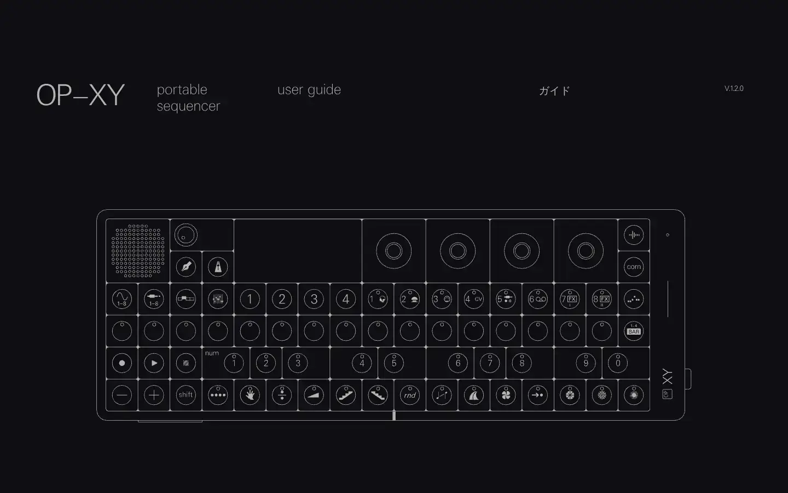
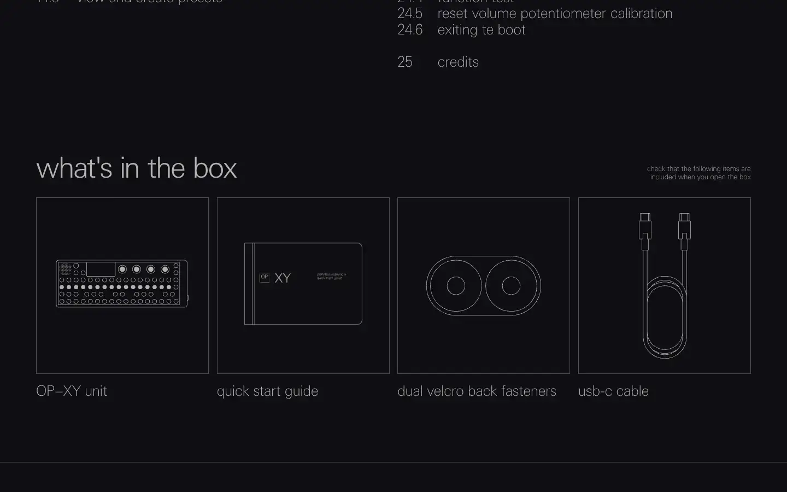

# Teenage Engineering OP-XY guide

Group: **The Siren family** · Tags: `siren` `synth` `displays` `manual`
Source: https://teenage.engineering/guides/op-xy (the maker's official product page; images are the maker's, kept here for study only)

**Why it is here:** The OP-XY manual: screen graphics for engines, envelopes and filters

- **What makes it work:** The OP-XY manual pages: white line drawings and small grey type on pure black.
- **Controls:** Not applicable.
- **Displays:** Line art of the hardware.
- **Colour:** Black and thin white lines.
- **Lesson for RUIN-1:** Pure black plus thin white line art is enough to explain a complex device.

