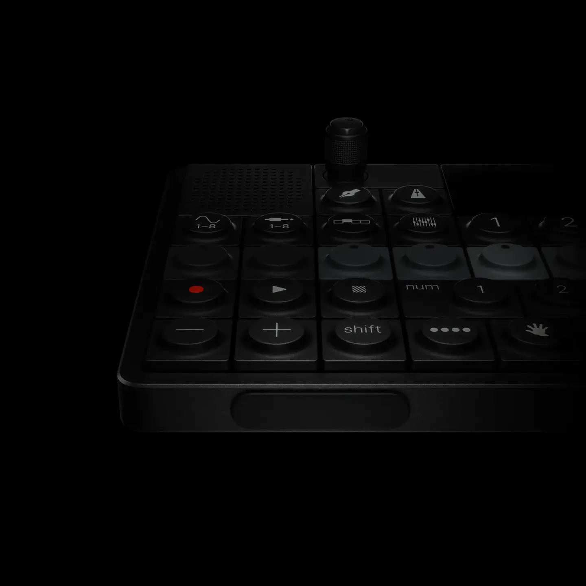
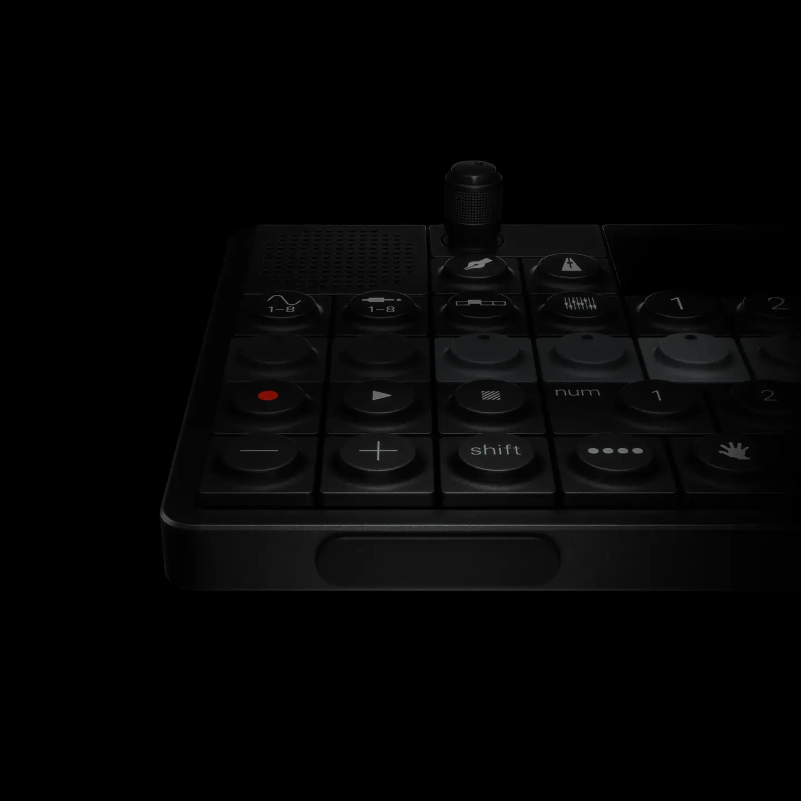
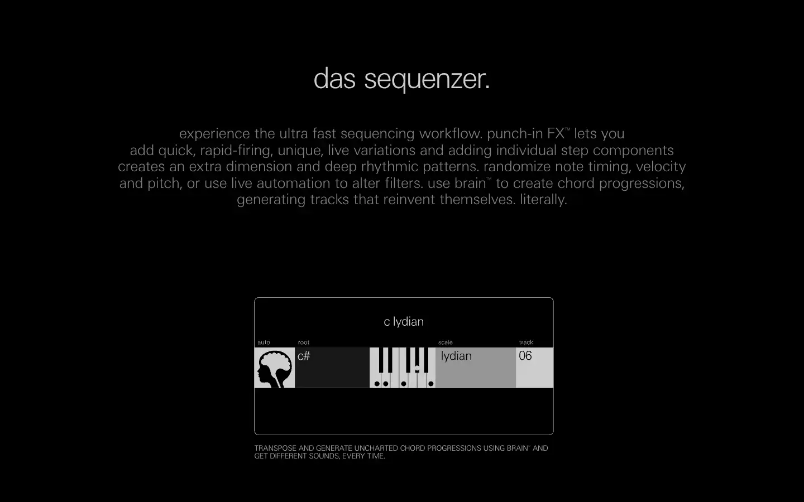
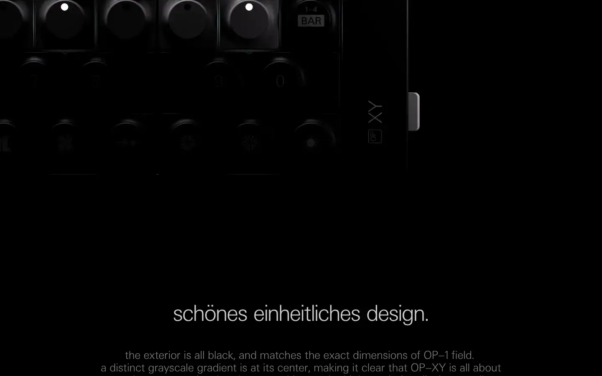

# Teenage Engineering OP-XY

Group: **The Siren family** · Tags: `siren` `synth` `hardware` `displays`
Source: https://teenage.engineering/products/op-xy (the maker's official product page; images are the maker's, kept here for study only)

**Why it is here:** TE's newest sequencer: a small display explaining a huge feature set with graphics

- **What makes it work:** OP-XY in black: dark anodised aluminium lit from one side, a tiny screen, the device photographed as sculpture.
- **Controls:** A grid of square keys and a few round encoders.
- **Displays:** A small screen with dense, crisp line graphics.
- **Colour:** All black; light and reflection make the form.
- **Lesson for RUIN-1:** One raking light on dark material is the whole mood: close to our siren light on black.

