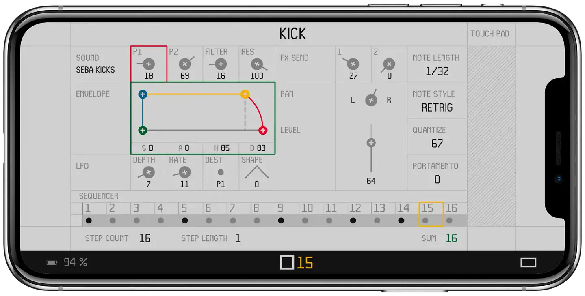
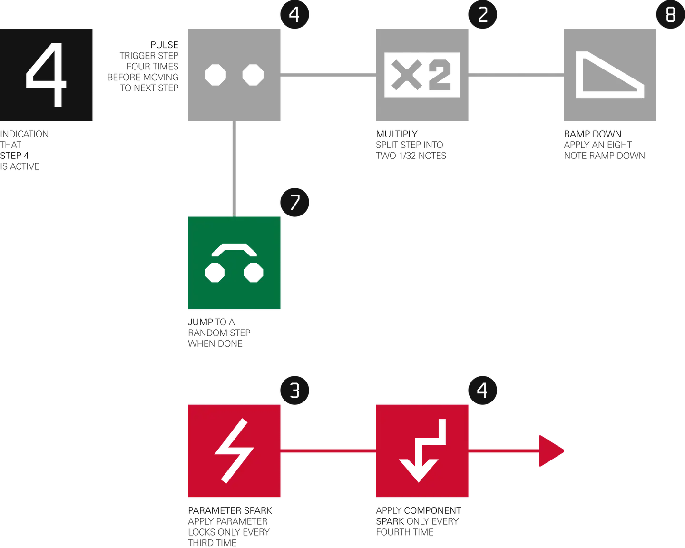
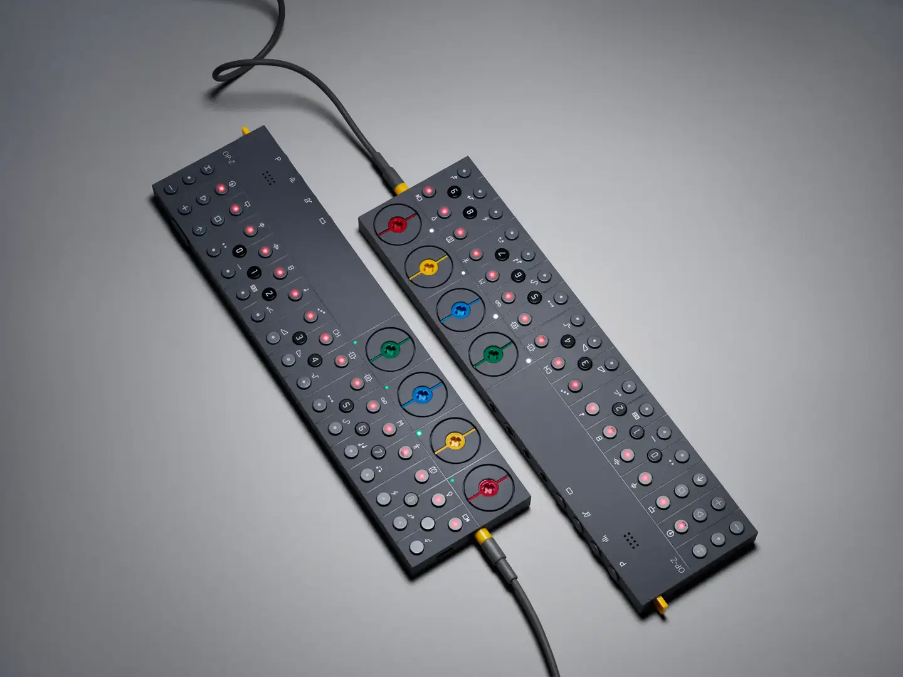
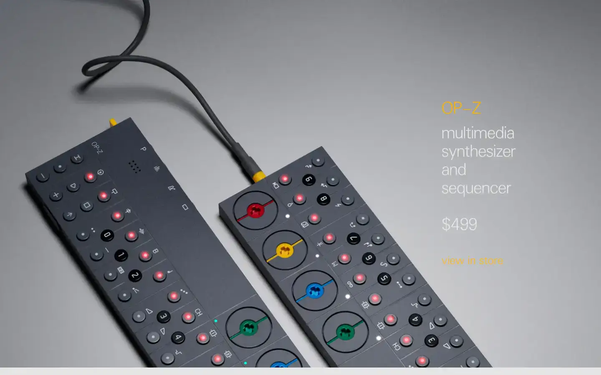

# Teenage Engineering OP-Z

Group: **The Siren family** · Tags: `siren` `hardware` `software` `colour-coding`
Source: https://teenage.engineering/products/op-z (the maker's official product page; images are the maker's, kept here for study only)

**Why it is here:** A device with an app as its screen: colour coding per track, very little text

- **What makes it work:** OP-Z: a dark slim body, colour-coded track keys, and a phone app as its screen, with flat white panels and one colour per track.
- **Controls:** Rows of small round keys, colour rings per track.
- **Displays:** The app: thin lines, small type, step grid, envelope graphics.
- **Colour:** Dark grey body; red, yellow, green, blue per track.
- **Lesson for RUIN-1:** Colour-code by function across hardware and screen; keep the screen flat and thin-lined.

