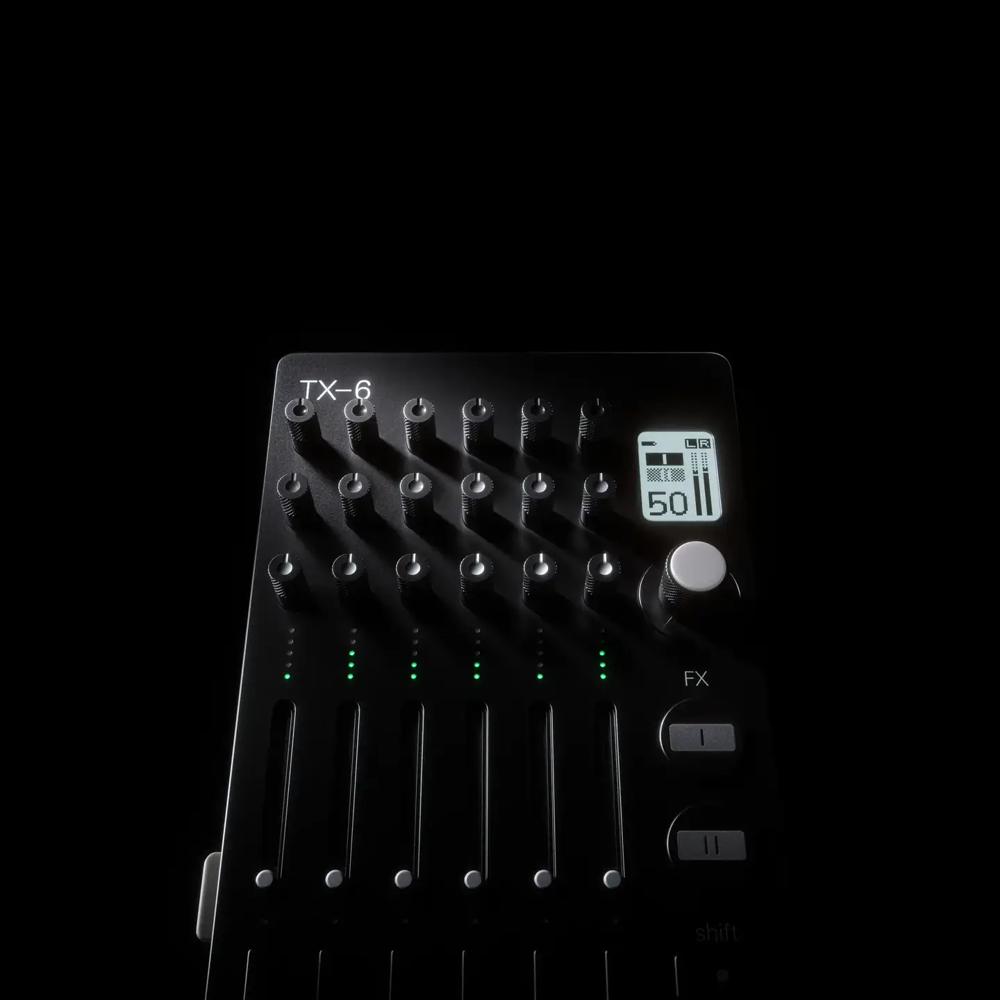
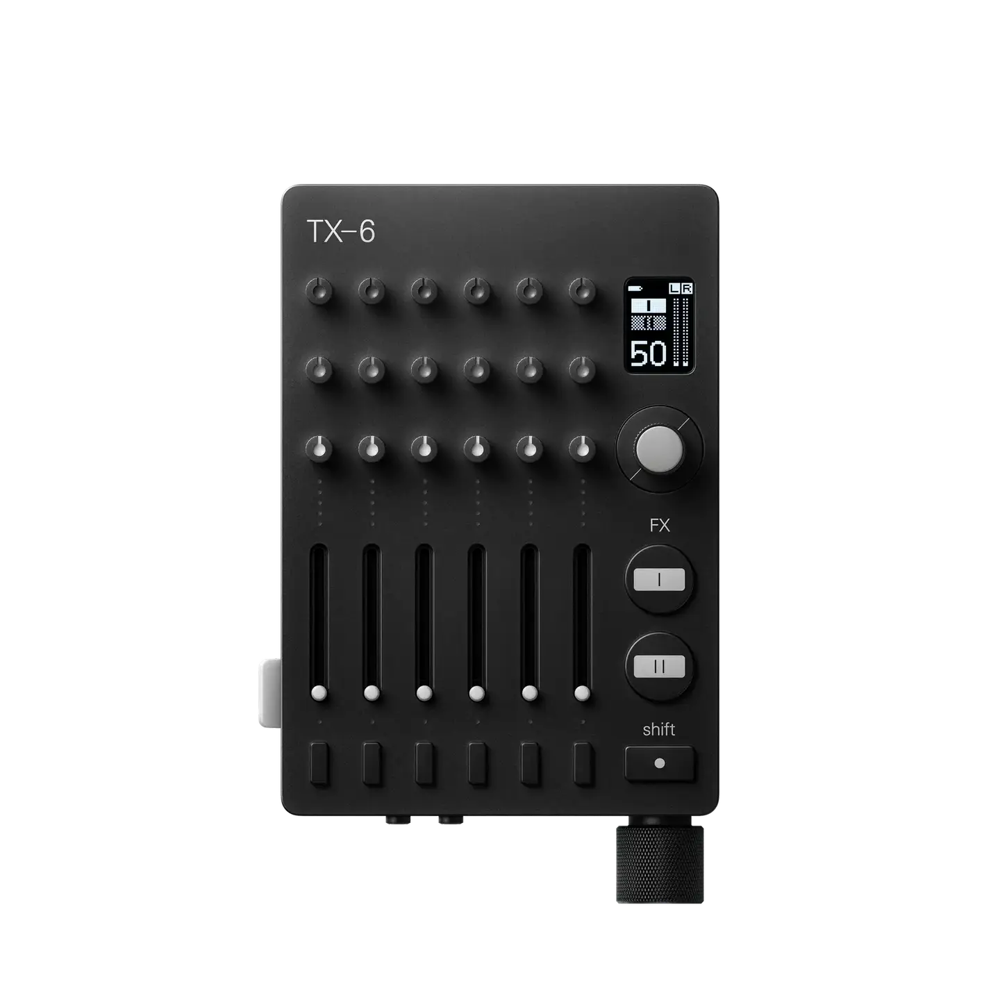
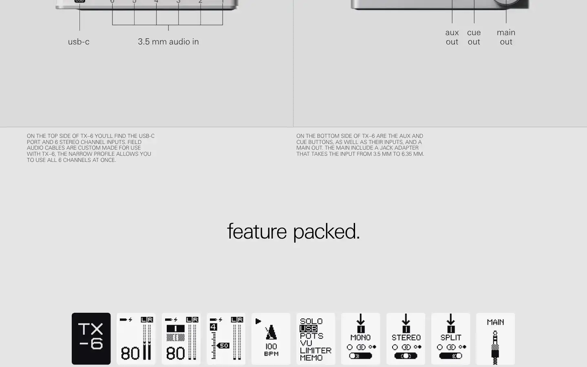

# Teenage Engineering TX-6

Group: **The Siren family** · Tags: `siren` `hardware` `dense` `materials`
Source: https://teenage.engineering/products/tx-6 (the maker's official product page; images are the maker's, kept here for study only)

**Why it is here:** A tiny, dense machined mixer: many controls, perfect order

- **What makes it work:** TX-6: a tiny machined mixer (silver or black) with knurled knobs, short faders and a small display.
- **Controls:** Knurled metal knobs and short faders in tight, perfect rows.
- **Displays:** A small screen with a big number.
- **Colour:** Black or silver metal, green LEDs.
- **Lesson for RUIN-1:** Density can look premium when everything sits on a strict grid and the materials are real.

