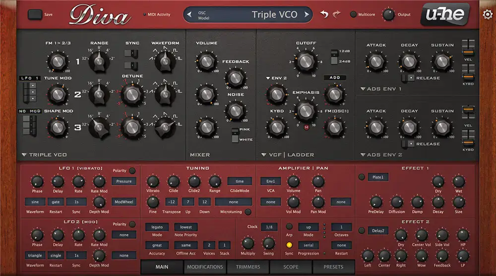
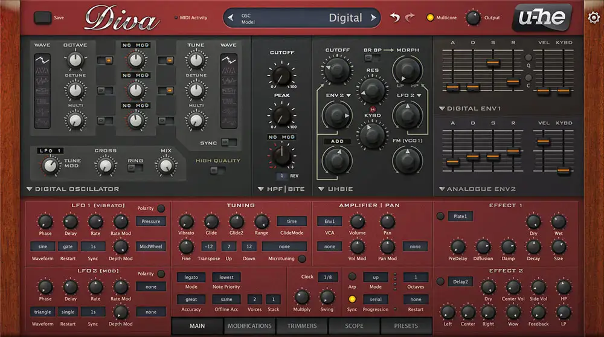
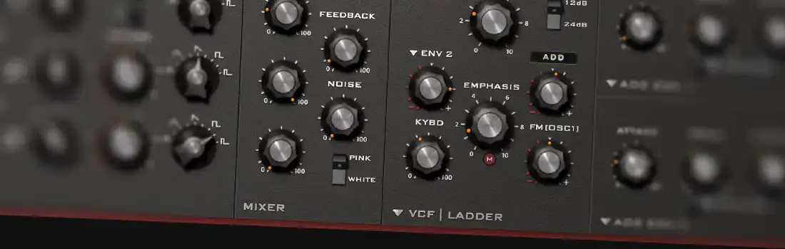
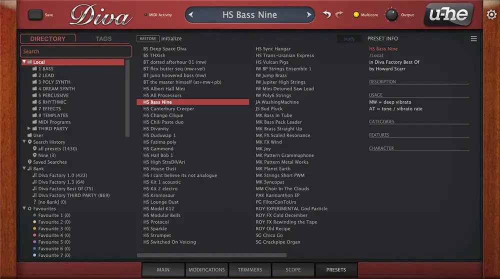

# u-he Diva

Group: **Synths and plugins** · Tags: `synth` `skeuo` `modules`
Source: https://u-he.com/products/diva/ (the maker's official product page; images are the maker's, kept here for study only)

**Why it is here:** The reference for analog-modelled synth faces: module panels, real knobs, readable at a glance

- **What makes it work:** Diva: a hardware-style panel of dark modules on wood cheeks, a red lower section, every section labelled in small caps.
- **Controls:** Many small black knobs with white pointers; vertical sliders for envelopes.
- **Displays:** Almost none: the knobs are the display.
- **Colour:** Dark grey, red, wood.
- **Lesson for RUIN-1:** Real modules in boxes with headers read instantly; but no displays makes it hard to see what the sound is doing.

