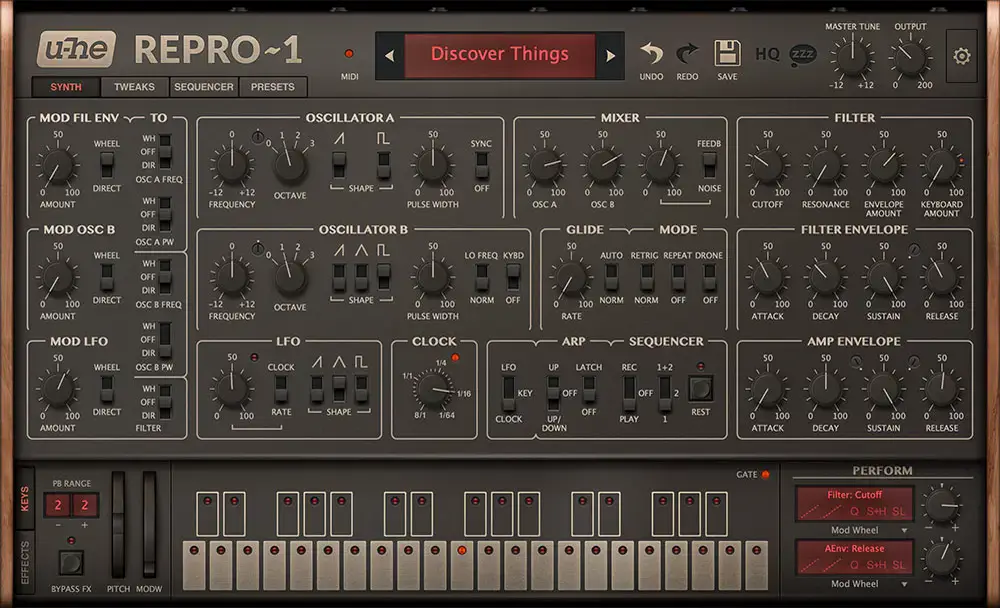
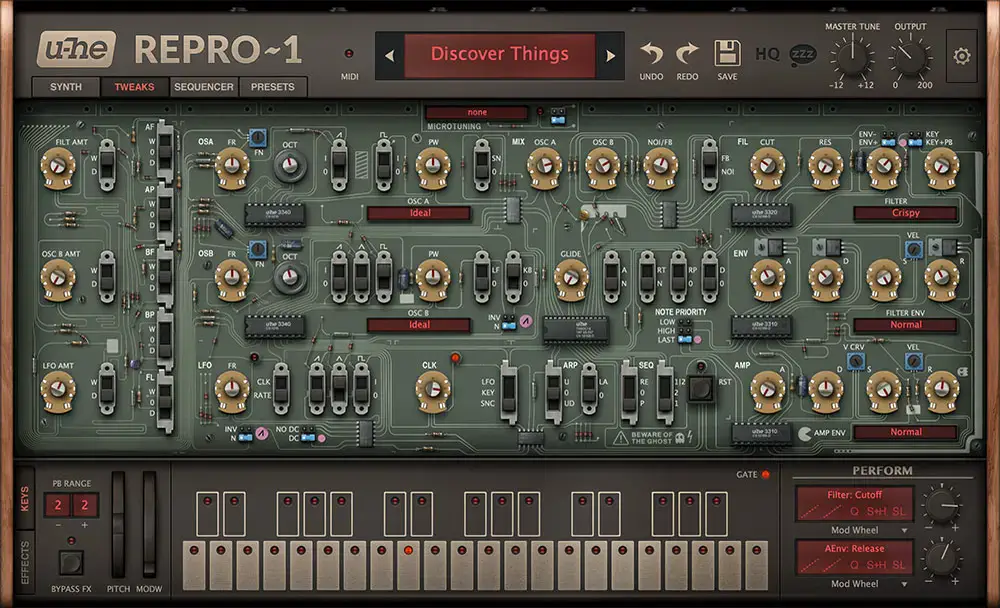
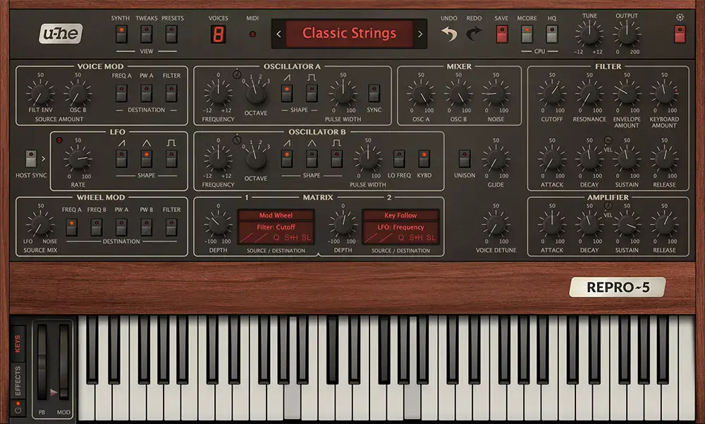
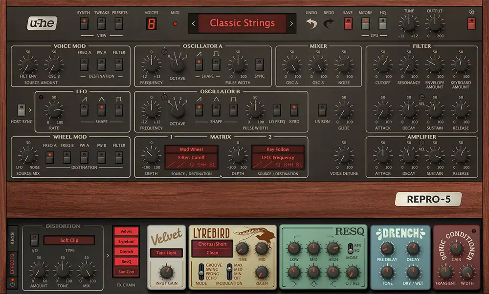

# u-he Repro

Group: **Synths and plugins** · Tags: `synth` `skeuo` `materials`
Source: https://u-he.com/products/repro/ (the maker's official product page; images are the maker's, kept here for study only)

**Why it is here:** Photoreal skeuomorphic hardware (Pro-One, Prophet-5) done tastefully

- **What makes it work:** Repro-1/5: photoreal hardware (Pro-One, Prophet-5) on wood, plus a pedalboard of coloured stomp boxes.
- **Controls:** Photoreal knobs and switches, each to scale.
- **Displays:** Small, hardware-style LED readouts.
- **Colour:** Dark brown panels, wood, colourful pedals.
- **Lesson for RUIN-1:** Skeuomorphism works when it is faithful and lit consistently; colour in small separate blocks (the pedals).

