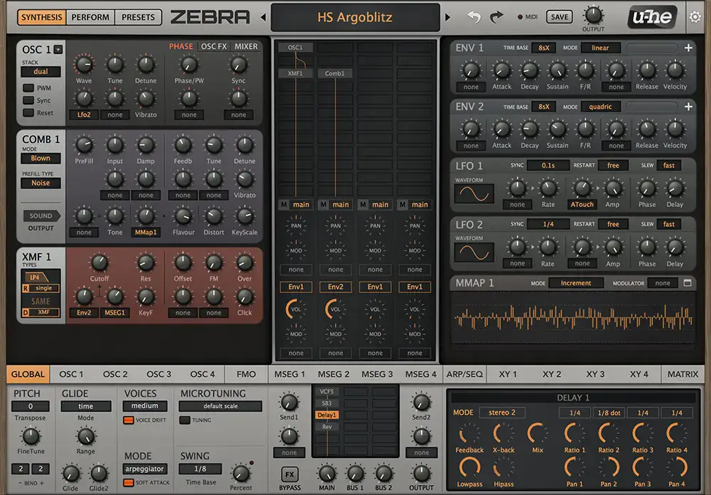
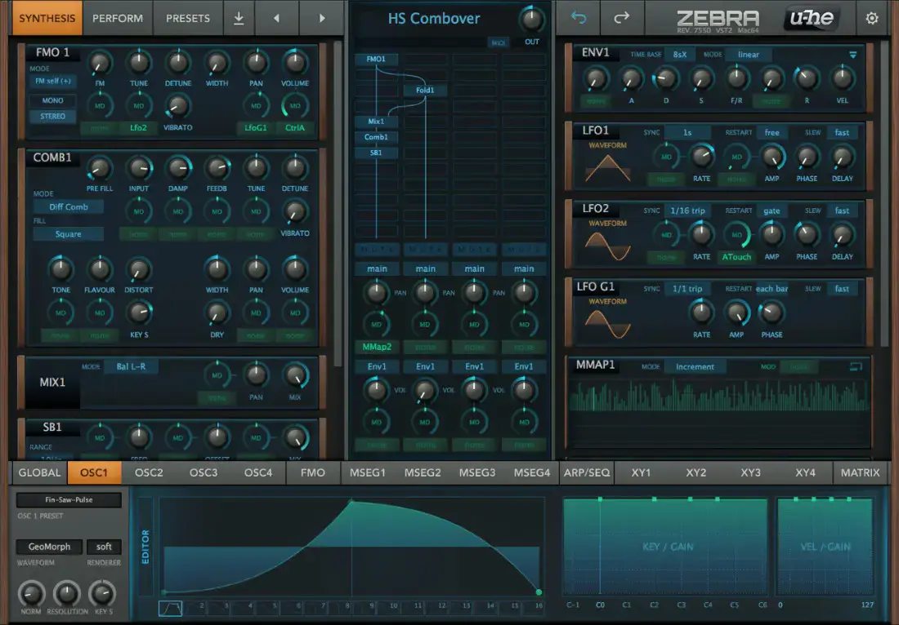
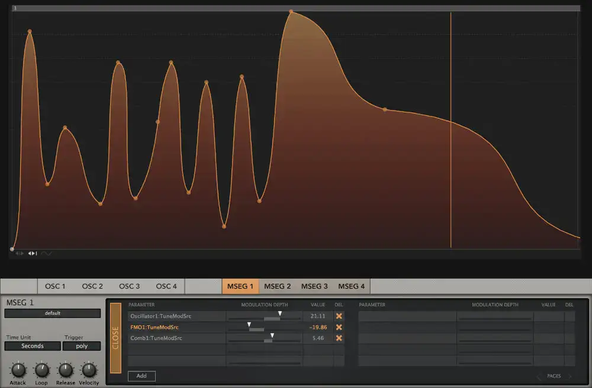
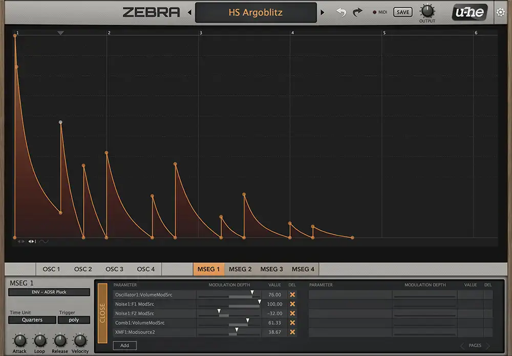

# u-he Zebra

Group: **Synths and plugins** · Tags: `synth` `dense` `modules` `modulation`
Source: https://u-he.com/products/zebra-legacy/ (the maker's official product page; images are the maker's, kept here for study only)

**Why it is here:** Huge modular synth on one page with grids and lit panels

- **What makes it work:** Zebra Legacy: a dense grid of lit panels with big orange editor displays (waveforms, MSEG envelopes).
- **Controls:** Small knobs in tight rows, tabs per module.
- **Displays:** Large orange displays that fill whole panels when editing.
- **Colour:** Dark grey with warm orange displays.
- **Lesson for RUIN-1:** A big warm-coloured display per module plus tight knob rows: closest to our 'display above each module' rule.

