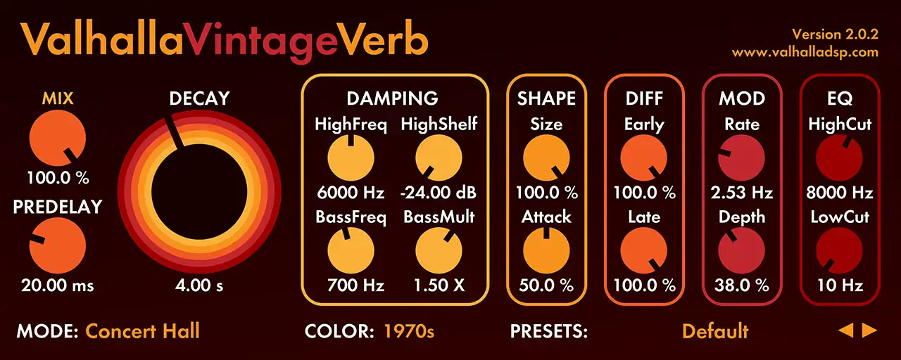
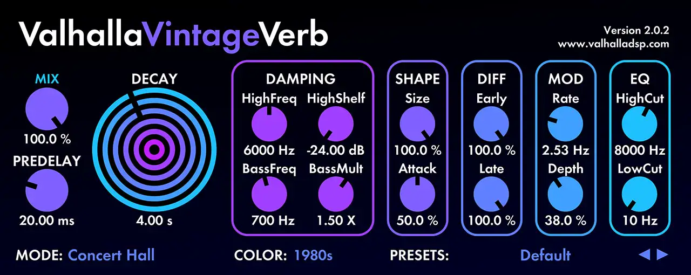
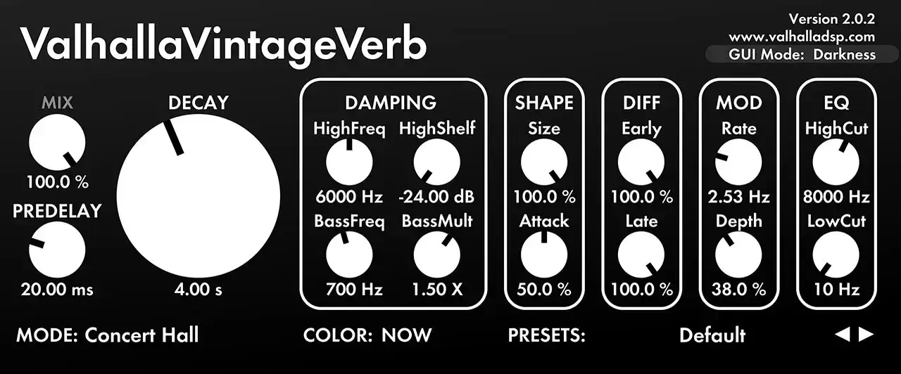
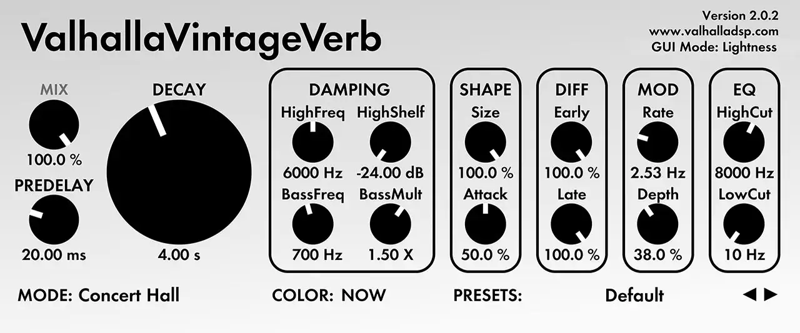

# Valhalla VintageVerb

Group: **Synths and plugins** · Tags: `plugin` `flat` `minimal`
Source: https://valhalladsp.com/shop/reverb/valhalla-vintage-verb/ (the maker's official product page; images are the maker's, kept here for study only)

**Why it is here:** Plain flat sliders that are completely clear: function first

- **What makes it work:** VintageVerb: a flat strip of labelled knobs in boxes, one big decay knob, colour themes (1970s, 1980s, Now).
- **Controls:** Plain round knobs with value text under each; one oversized key knob.
- **Displays:** None, values as text.
- **Colour:** Swappable flat themes.
- **Lesson for RUIN-1:** Function first: one big knob for the main move and flat, readable values. Size shows importance.

