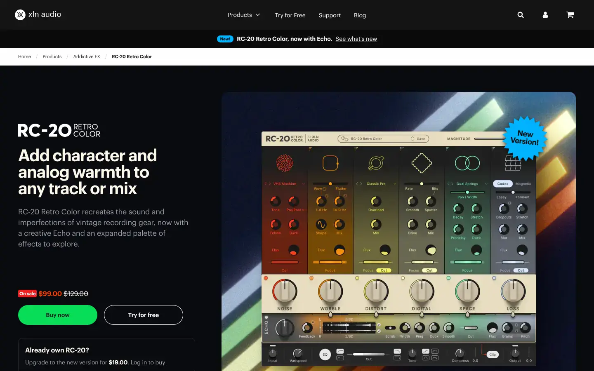
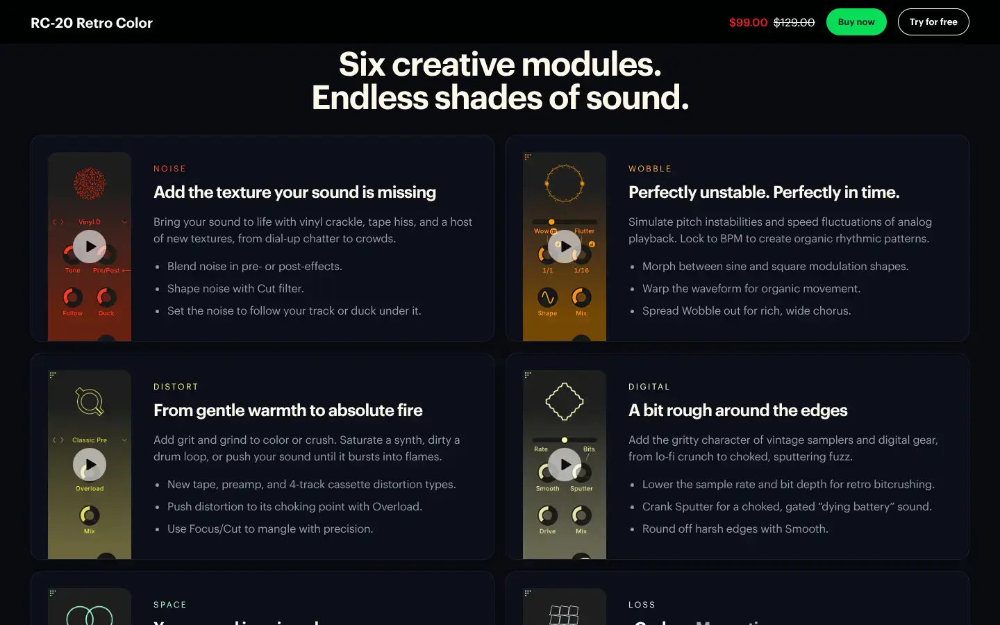
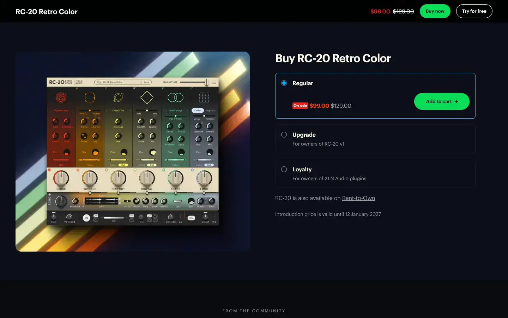

# XLN Audio RC-20 Retro Color

Group: **Dark, cinematic, LORN-fit** · Tags: `lorn` `plugin` `worn` `modules`
Source: https://www.xlnaudio.com/products/addictive_fx/effect/rc-20_retro_color (the maker's official product page; images are the maker's, kept here for study only)

**Why it is here:** The wear/texture plugin: noise, wobble, distortion, space, as modules

- **What makes it work:** RC-20: six coloured modules (noise, wobble, distortion, digital, space, magnetic) side by side, each with a display and knobs.
- **Controls:** Cream knobs with coloured rings, a big flux display per module.
- **Displays:** An animated display on top of each module.
- **Colour:** Retro cream with a different colour per module.
- **Lesson for RUIN-1:** Six modules, each with its own colour and a display on top: a direct model for a page of modules.

