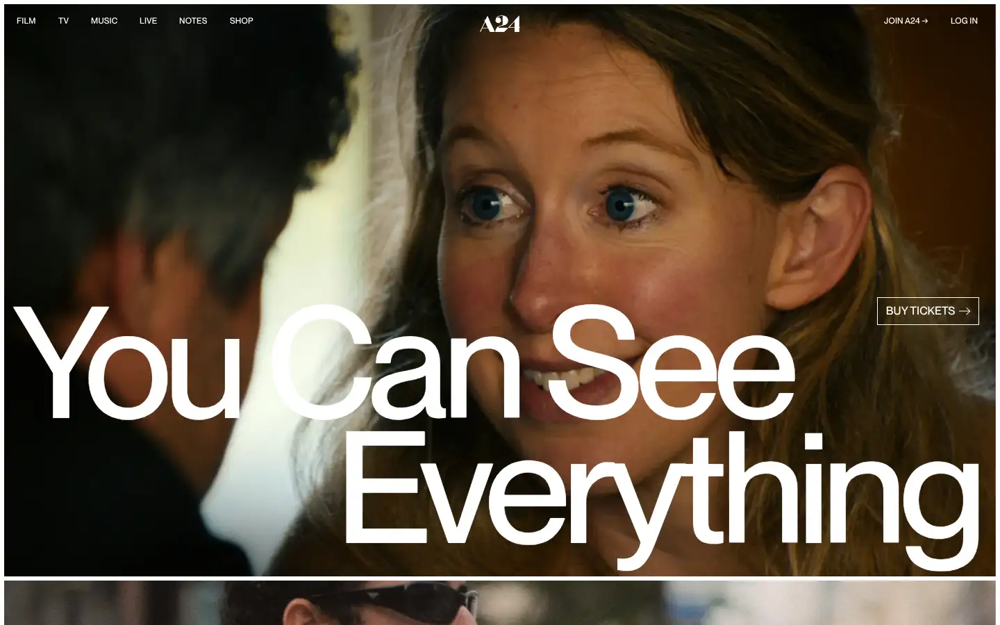
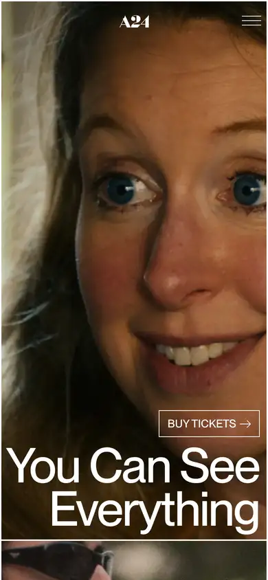

# a24

https://a24films.com
Tags: lorn, film, dark, hero
Picked because: A24: the benchmark for dark, editorial film-studio design

## What makes it work
Giant tight-tracked grotesk set straight over a film still; the type is part of the image.

## Good reference for
Type-led heroes, editorial sections.

## Lesson for RUIN-1
Big confident type over the product can carry the whole first screen.

## Measured (from the live page)
- First screen: light (average brightness 0.321)
- Background: #0e0e0d; palette by area: #ffffff, #0e0e0d, #fcfbfa, #f1f1f1, #b2ada6, #d6d4d1; accent: none
- Fonts: neueMontreal, neueMontrealMono
- Headline: neueMontreal, 225px, weight 485, tracking -11.25px (“You Can SeeEverything”)
- Section title: neueMontreal, 400px, weight 485, tracking -20px (“Club Kid”)
- Body: neueMontreal, 18px, weight 420, tracking 0.0605205px (“The Encyclopedia of Movie Cats features over 1,000 cats, fro”)
- Navigation: neueMontreal, 12px, weight 485, uppercase, tracking 0.06px (“Film”)
- Buttons: “Buy Tickets” 39px tall, radius 0px, 16px 485 uppercase, border 1px rgb(255, 255, 255); “Buy Tickets” 39px tall, radius 0px, 16px 485 uppercase, border 1px rgb(255, 255, 255); “Get Updates” 39px tall, radius 0px, 16px 485 uppercase, border 1px rgb(255, 255, 255); “Buy Tickets” 31px tall, radius 0px, 14px 485 uppercase, border 1px rgb(14, 14, 13)
- Section spacing (median vertical padding): 84px; page height 8224px
- Phone: headline 70px, side margin 8px

## Screenshots
 

Whole page: [desktop](desktop-full.webp) · [phone](phone-full.webp)
