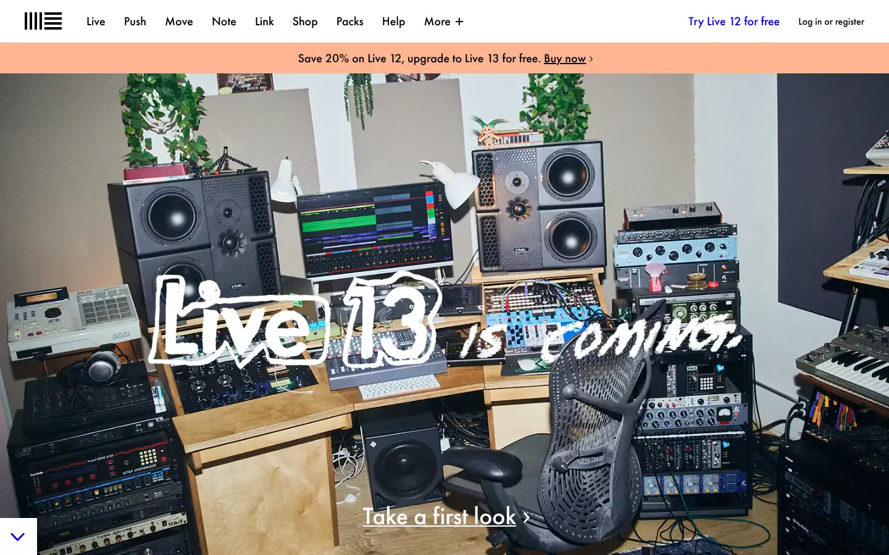
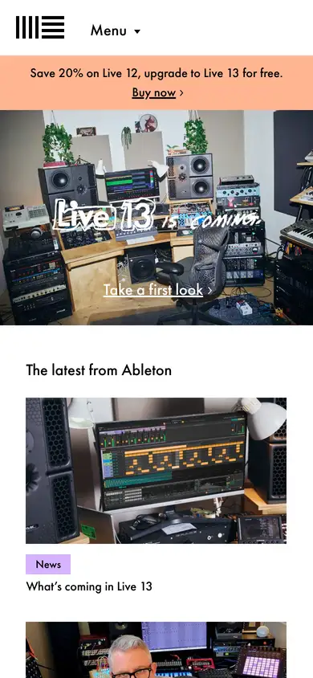

# ableton

https://www.ableton.com/en/
Tags: music, software, type-led
Picked because: Ableton: the best-made music software site, editorial

## What makes it work
Real studio photography with a hand-drawn headline; friendly and human.

## Good reference for
Community and brand sections.

## Lesson for RUIN-1
A human touch (handwriting, real rooms) offsets a dark technical brand.

## Measured (from the live page)
- First screen: light (average brightness 0.497)
- Background: #f3f3f3; palette by area: #ffffff, #22242c, #eeeeee, #ffb591, #0000ff, #ff8389; accent: #ffb591
- Fonts: futura-pt, Arial
- Headline: futura-pt, 40px, weight 700 (“The latest from Ableton”)
- Section title: futura-pt, 40px, weight 700 (“The latest from Ableton”)
- Body: not measured
- Navigation: futura-pt, 20px, weight 700 (“Live”)
- Buttons: “Scroll down” 60px tall, radius 0px, 16px 400 none
- Section spacing (median vertical padding): 30px; page height 3378px
- Phone: headline ?, side margin 15px

## Screenshots
 

Whole page: [desktop](desktop-full.webp) · [phone](phone-full.webp)
