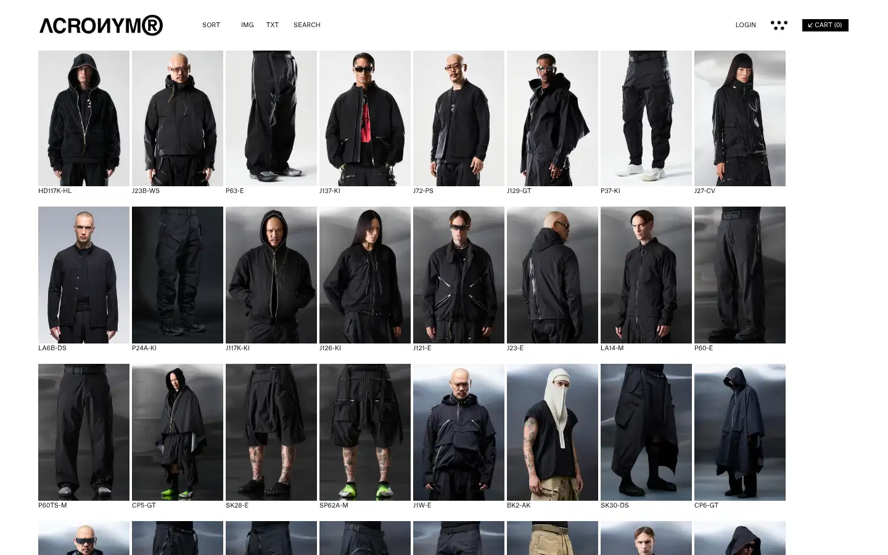
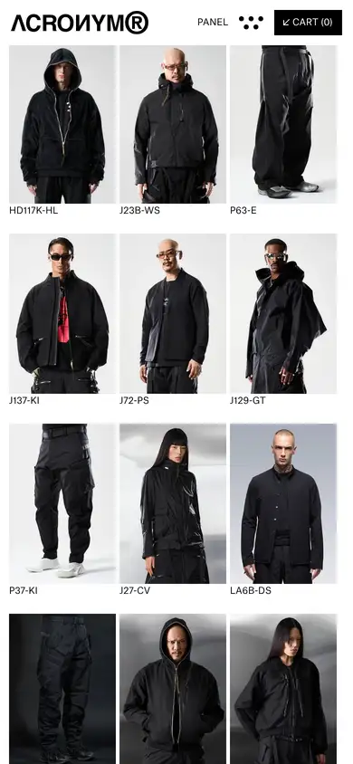

# acronym

https://acrnm.com
Tags: fashion, type-led, outlier
Picked because: Acronym: technical, brutal, type-led outlier

## What makes it work
A strict grid of products on white, tiny technical labels, no decoration.

## Good reference for
Catalogue and grid pages.

## Lesson for RUIN-1
Technical, tiny labels give a precise, engineered feel.

## Measured (from the live page)
- First screen: light (average brightness 0.563)
- Background: #ffffff; palette by area: #ffffff; accent: none
- Fonts: Atlas Grotesk Web Regular
- Headline: not measured
- Section title: not measured
- Body: Atlas Grotesk Web Regular, 10px, weight 400 (“© 2026 by ǍCROŇYMř GmbH”)
- Navigation: Atlas Grotesk Web Regular, 10px, weight 400 (“ACRONYM®”)
- Buttons: none found
- Section spacing (median vertical padding): ?; page height 7451px
- Phone: headline ?, side margin 12px

## Screenshots
 

Whole page: [desktop](desktop-full.webp) · [phone](phone-full.webp)
