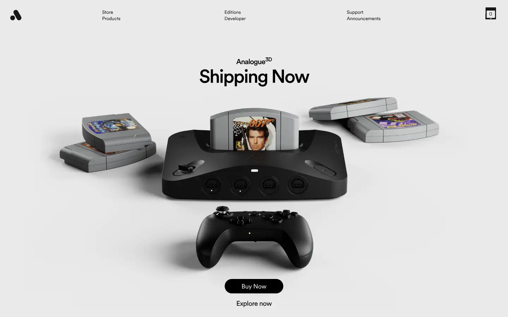
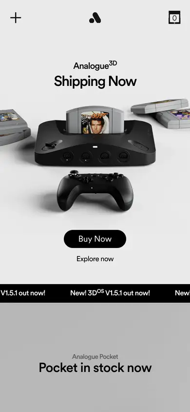

# analogue

https://www.analogue.co
Tags: lorn, hardware, product, dark, hero
Picked because: Analogue: dark, crafted hardware product pages

## What makes it work
A clean light studio shot of the product, centred, with one short title and a pill button.

## Good reference for
Product heroes and buy moments.

## Lesson for RUIN-1
Product, name, one button: the cleanest possible buy path.

## Measured (from the live page)
- First screen: light (average brightness 0.786)
- Background: #ffffff; palette by area: #ffffff, #eaeaea, #666666, #bfbfbf, #868686; accent: none
- Fonts: circularXx
- Headline: circularXx, 53px, weight 500, tracking -2.64489px (“Shipping Now”)
- Section title: circularXx, 47px, weight 500 (“Mega Sg+”)
- Body: circularXx, 13px, weight 400 (“Subscribe to our newsletterfor the latest updates and news”)
- Navigation: circularXx, 13px, weight 400 (“Store”)
- Buttons: “Buy Now” 41px tall, radius 3.35544e+07px, 18px 400 none, border 0px lab(91.6229 -0.159115 -2.26791); “New! 3DOS V1.5.1 out now!New! ” 47px tall, radius 0px, 16px 500 none, border 0px lab(91.6229 -0.159115 -2.26791); “Available now” 41px tall, radius 3.35544e+07px, 18px 400 none, border 0px lab(91.6229 -0.159115 -2.26791); “Sold Out” 41px tall, radius 3.35544e+07px, 18px 400 none, border 0px lab(91.6229 -0.159115 -2.26791)
- Section spacing (median vertical padding): 118px; page height 5781px
- Phone: headline 29px, side margin 94px

## Screenshots
 

Whole page: [desktop](desktop-full.webp) · [phone](phone-full.webp)
