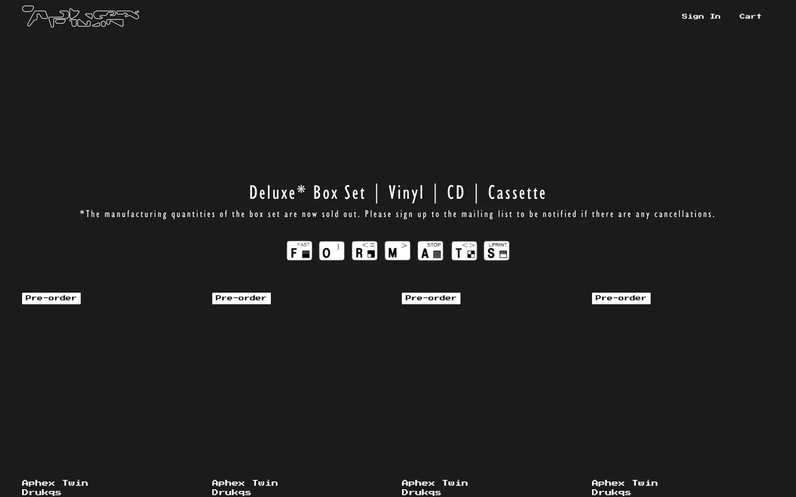
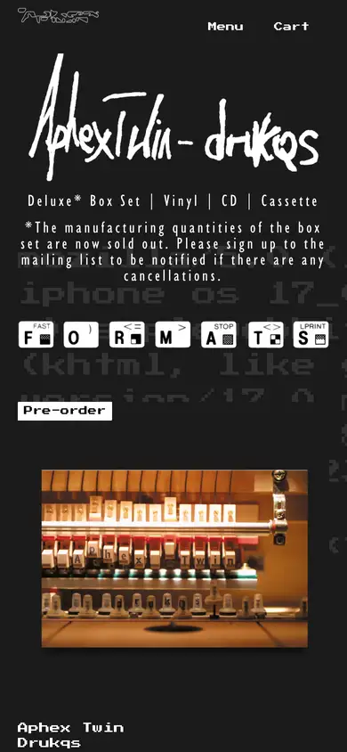

# aphex-twin

https://aphextwin.warp.net
Tags: lorn, music, outlier
Picked because: Aphex Twin: raw, strange, anti-template; a deliberate outlier

## What makes it work
Deliberately broken: pixel and terminal type, raw text dumped on black, nothing polished.

## Good reference for
An outlier for texture and attitude, not for structure.

## Lesson for RUIN-1
A little controlled rawness (a decayed-signal line, mono labels) reads as authentic; a lot reads as a joke.

## Measured (from the live page)
- First screen: dark (average brightness 0.124)
- Background: #1b1b1b; palette by area: #1b1b1b, #ffffff, #ffffff at 10%, #ffffff at 50%; accent: none
- Fonts: Press Start 2P, Humanist521Cn
- Headline: Press Start 2P, 12px, weight 700 (“Aphex Twin”)
- Section title: not measured
- Body: Press Start 2P, 6px, weight 400 (“Powered by Ochre. Registered office: Spectrum House, 32–34 G”)
- Navigation: Press Start 2P, 12px, weight 700 (“Aphex Twin”)
- Buttons: “Aphex Twin” 60px tall, radius 0px, 12px 700 none; “Sign In” 60px tall, radius 0px, 10px 400 none, border 2px rgba(0, 0, 0, 0); “Cart 0” 60px tall, radius 0px, 10px 400 none, border 2px rgba(0, 0, 0, 0); “Releases” 64px tall, radius 0px, 10px 400 none, border 2px rgba(0, 0, 0, 0)
- Section spacing (median vertical padding): 34px; page height 2239px
- Phone: headline 12px, side margin 20px

## Screenshots
 

Whole page: [desktop](desktop-full.webp) · [phone](phone-full.webp)
