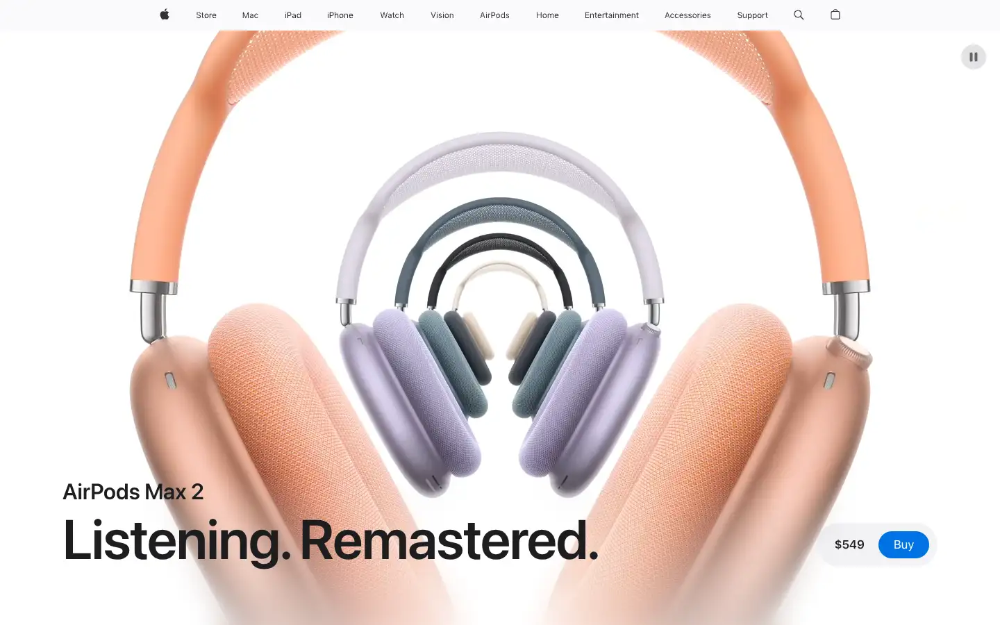
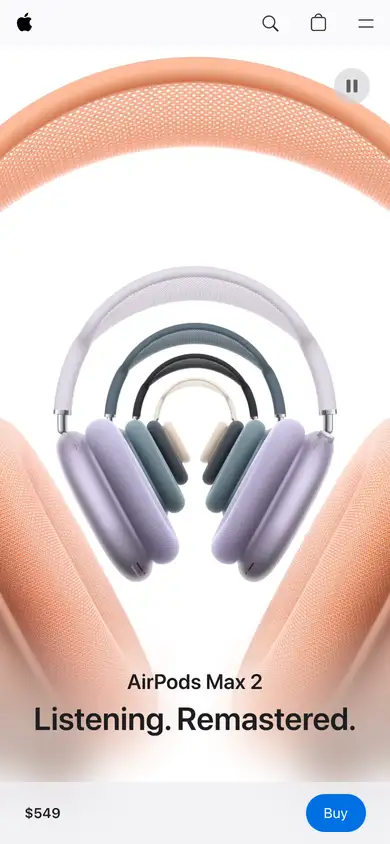

# apple-airpods-max

https://www.apple.com/airpods-max/
Tags: product, hero, dark, motion, specs
Picked because: Apple AirPods Max: the reference for a premium audio product page

## What makes it work
One huge product image, one big headline, price and Buy in a small pill: nothing else.

## Good reference for
Product heroes, sticky buy bars.

## Lesson for RUIN-1
A tiny persistent price-plus-Buy pill: what our phone pin bar wants to be.

## Measured (from the live page)
- First screen: light (average brightness 0.874)
- Background: #ffffff; palette by area: #f5f5f7, #ffffff, #fafafc, #e8e8ed at 40%, #1d1d1f, #ffffff at 56%; accent: none
- Fonts: SF Pro Text, SF Pro Display
- Headline: SF Pro Display, 32px, weight 600, tracking 0.128px (“AirPods Max 2”)
- Section title: SF Pro Text, 12px, weight 400, tracking -0.12px (“Shop”)
- Body: SF Pro Text, 17px, weight 600, tracking -0.374px (“$549 or $91.50/mo. for 6 mo.”)
- Navigation: SF Pro Text, 17px, weight 600, tracking -0.374px (“Apple”)
- Buttons: “Buy” 39px tall, radius 980px, 17px 400 none, border 1px rgba(0, 0, 0, 0); “Learn more” 44px tall, radius 980px, 17px 400 none, border 1px rgba(0, 0, 0, 0)
- Section spacing (median vertical padding): 80px; page height 17847px
- Phone: headline 21px, side margin 48px

## Screenshots
 

Whole page: [desktop](desktop-full.webp) · [phone](phone-full.webp)
