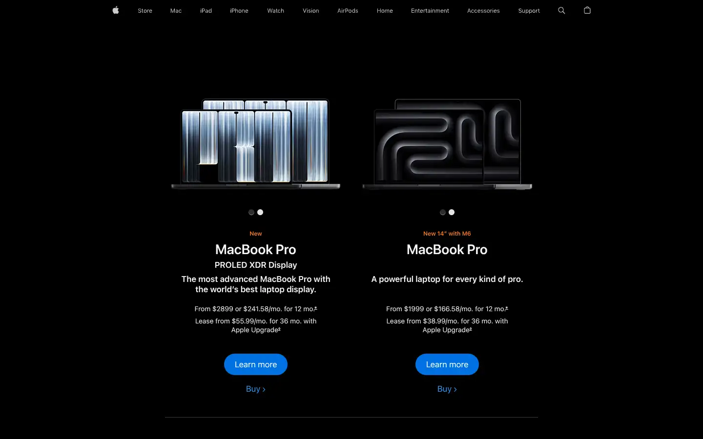
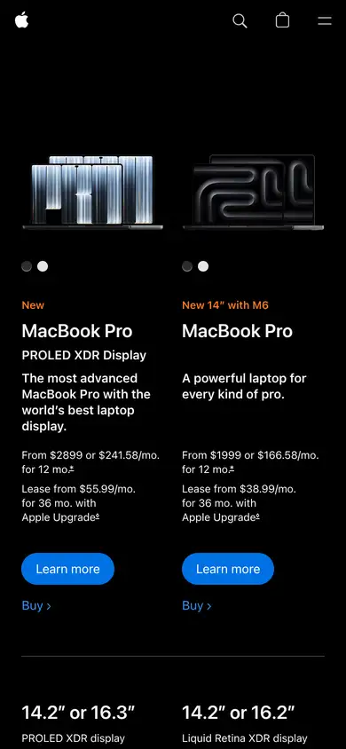

# apple-macbook-pro

https://www.apple.com/macbook-pro/
Tags: product, hero, dark, specs, motion
Picked because: Apple MacBook Pro: dark product storytelling, specs as design

## What makes it work
Black page, products as glowing objects, short centred copy, two small blue links.

## Good reference for
Dark product heroes, comparison rows.

## Lesson for RUIN-1
On black, let the product be the only light source.

## Measured (from the live page)
- First screen: dark (average brightness 0.036)
- Background: #ffffff; palette by area: #1d1d1f, #000000 at 40%, #f5f5f7, #ffffff at 56%, #e8e8ed, #ffffff at 80%; accent: #0071e3
- Fonts: SF Pro Text, SF Pro Display
- Headline: SF Pro Text, 34px, weight 600, tracking -0.374px (“MacBook Pro”)
- Section title: SF Pro Text, 12px, weight 400, tracking -0.12px (“Shop”)
- Body: SF Pro Text, 17px, weight 600, tracking -0.374px (“The most advanced MacBook Pro with the world’s best laptop d”)
- Navigation: SF Pro Text, 17px, weight 600, tracking -0.374px (“Apple”)
- Buttons: “Learn more” 44px tall, radius 980px, 17px 400 none, border 1px rgba(0, 0, 0, 0); “Learn more” 36px tall, radius 980px, 14px 400 none, border 1px rgba(0, 0, 0, 0); “Learn more” 44px tall, radius 980px, 17px 400 none, border 1px rgba(0, 0, 0, 0); “Learn more” 36px tall, radius 980px, 14px 400 none, border 1px rgba(0, 0, 0, 0)
- Section spacing (median vertical padding): 24px; page height 3815px
- Phone: headline 34px, side margin 48px

## Screenshots
 

Whole page: [desktop](desktop-full.webp) · [phone](phone-full.webp)
