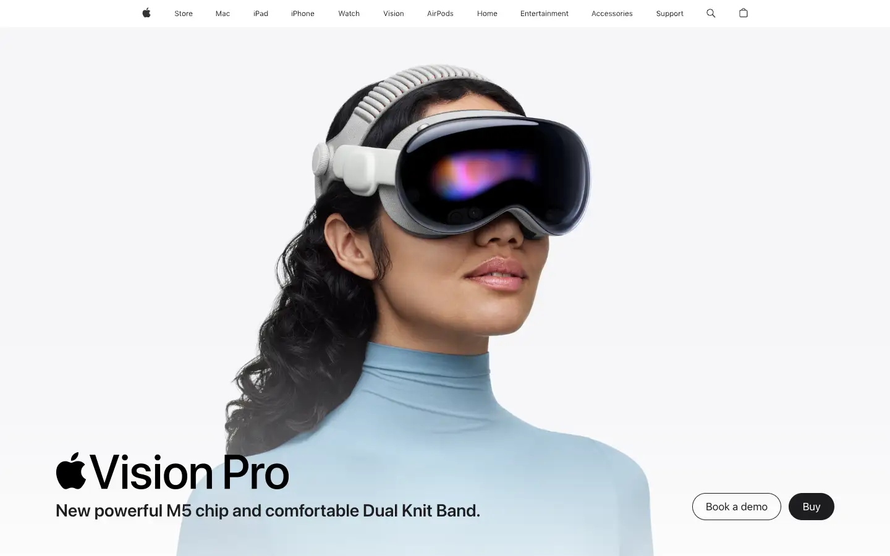
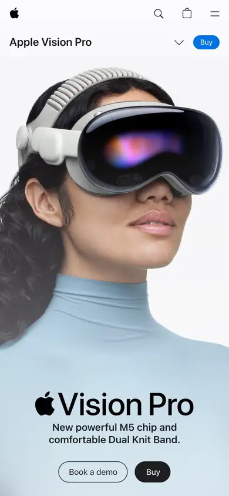

# apple-vision-pro

https://www.apple.com/apple-vision-pro/
Tags: product, hero, motion
Picked because: Apple Vision Pro: cinematic, motion-led product page

## What makes it work
A bright face and product, a short wordmark and one line; motion sells the experience.

## Good reference for
Experience-led product pages.

## Lesson for RUIN-1
Show the experience (sound, motion), not only the object.

## Measured (from the live page)
- First screen: light (average brightness 0.833)
- Background: #ffffff; palette by area: #f5f5f7, #ffffff, #e8e8ed at 40%, #1d1d1f, #86868b, #fafafc at 80%; accent: none
- Fonts: SF Pro Text, SF Pro Display
- Headline: SF Pro Text, 34px, weight 600, tracking -0.374px (“Apple Vision Pro”)
- Section title: SF Pro Text, 12px, weight 400, tracking -0.12px (“Shop”)
- Body: SF Pro Text, 14px, weight 600, tracking -0.224px (“Stream Wolfs on Apple TV with a subscription”)
- Navigation: SF Pro Text, 17px, weight 600, tracking -0.374px (“Apple”)
- Buttons: “Book a demo” 44px tall, radius 980px, 17px 400 none, border 1px rgb(29, 29, 31); “Buy” 44px tall, radius 980px, 17px 400 none, border 1px rgba(0, 0, 0, 0)
- Section spacing (median vertical padding): 44px; page height 32716px
- Phone: headline 34px, side margin 48px

## Screenshots
 

Whole page: [desktop](desktop-full.webp) · [phone](phone-full.webp)
