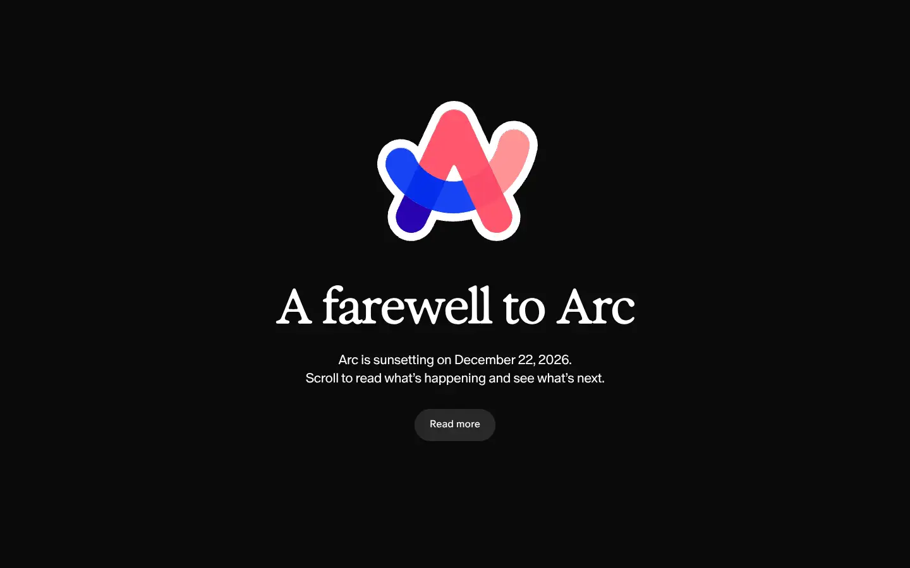
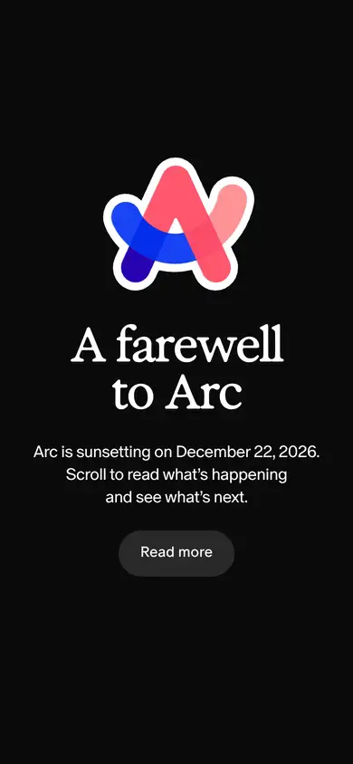

# arc

https://arc.net
Tags: software, playful, outlier
Picked because: Arc: playful, distinctive; a contrasting outlier

## What makes it work
A colourful logo on black with an expressive serif headline and one small button.

## Good reference for
Single-message announcement pages.

## Lesson for RUIN-1
One message, one button, a lot of black.

## Measured (from the live page)
- First screen: dark (average brightness 0.067)
- Background: #0b0b0b; palette by area: #ffffff, #0b0b0b, #ff8a91, #f7f7f7, #1a1a1a, #000000 at 3%; accent: #ff8a91
- Fonts: Exposure VAR, ABC Oracle, ABC Favorit Mono, Arial, -apple-system, Georgia
- Headline: Exposure VAR, 76px, weight 600, tracking -2.432px (“A farewell to Arc”)
- Section title: ABC Oracle, 38px, weight 350, tracking -1.14px (“We’ve decided to sunset Arc on December 22, 2026”)
- Body: ABC Oracle, 21px, weight 350, tracking -0.63px (“Arc is sunsetting on December 22, 2026.Scroll to read what’s”)
- Navigation: not measured
- Buttons: “Read more” 50px tall, radius 60px, 16px 400 none; “Download Dia” 60px tall, radius 12px, 18px 350 none
- Section spacing (median vertical padding): 182px; page height 6173px
- Phone: headline 52px, side margin 33px

## Screenshots
 

Whole page: [desktop](desktop-full.webp) · [phone](phone-full.webp)
