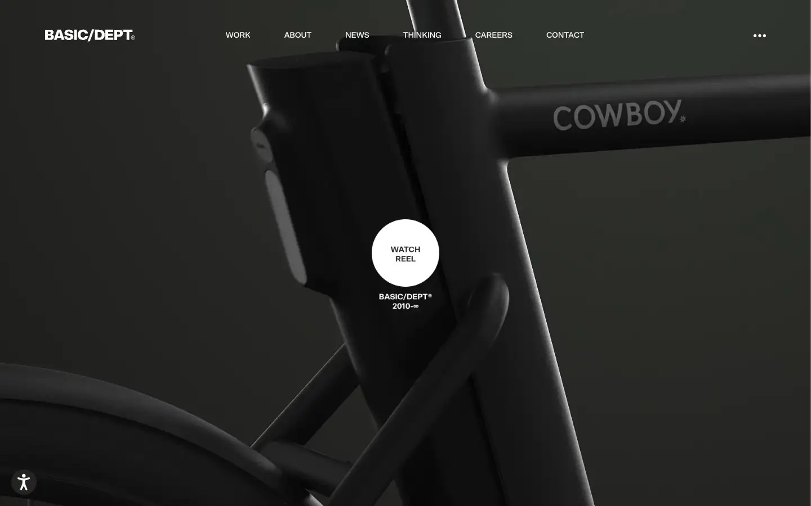
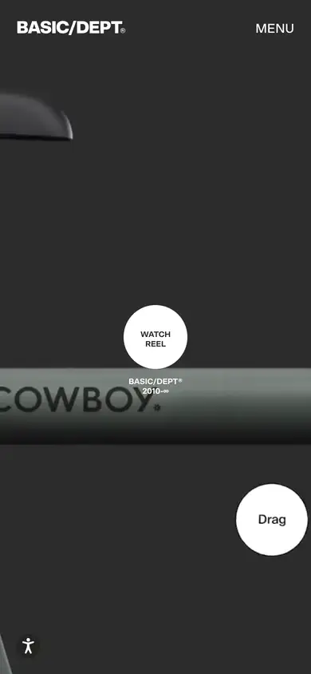

# basic

https://www.basicagency.com
Tags: studio, motion, dark
Picked because: BASIC/DEPT: premium digital studio, dark motion

## What makes it work
Dark product photography with a round 'watch reel' button floating on it.

## Good reference for
Video-led heroes.

## Lesson for RUIN-1
A round floating play button on the hero invites sound and motion.

## Measured (from the live page)
- First screen: dark (average brightness 0.146)
- Background: #f4f4f4; palette by area: #252422, #f4f4f4, #f9cdcd, #191918, #ffffff, #292826; accent: none
- Fonts: SctoGroteskA
- Headline: SctoGroteskA, 42px, weight 700, uppercase, tracking -2.1px (“Featured Engagements”)
- Section title: SctoGroteskA, 42px, weight 700, uppercase, tracking -2.1px (“Featured Engagements”)
- Body: SctoGroteskA, 14px, weight 400, uppercase, tracking -0.28px (“(5) Internal Works©26 c/o BASIC/DEPT®”)
- Navigation: SctoGroteskA, 14px, weight 400, uppercase, tracking -0.18px (“Work”)
- Buttons: “See The Work” 32px tall, radius 16px, 12px 700 uppercase, border 1px rgb(37, 36, 34); “About Us” 32px tall, radius 16px, 12px 700 uppercase, border 1px rgb(37, 36, 34); “View All” 32px tall, radius 16px, 12px 700 uppercase, border 1px rgb(37, 36, 34)
- Section spacing (median vertical padding): 90px; page height 10198px
- Phone: headline ?, side margin 21px

## Screenshots
 

Whole page: [desktop](desktop-full.webp) · [phone](phone-full.webp)
