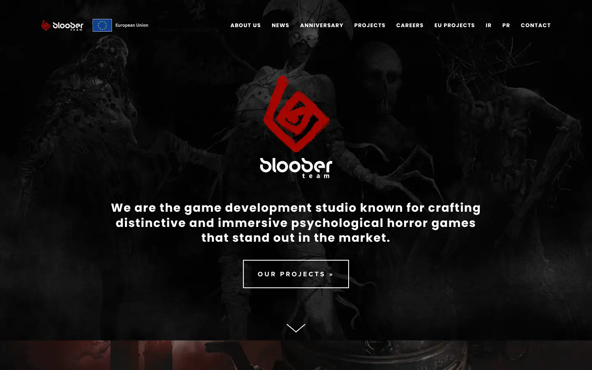
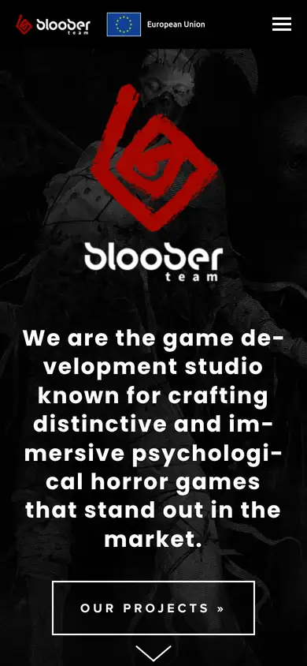

# bloober

https://blooberteam.com
Tags: lorn, games, dark
Picked because: Bloober Team: psychological horror studio

## What makes it work
A red logo glowing out of a dark textured scene; centred statement and one outlined button.

## Good reference for
Dark brand openers.

## Lesson for RUIN-1
A single red accent in a sea of near-black: the same move as our ember.

## Measured (from the live page)
- First screen: dark (average brightness 0.063)
- Background: #080808; palette by area: #141414, #ffffff at 80%, #ffffff, #ffffff at 20%; accent: none
- Fonts: Noto Sans, Ubuntu, Poppins, proxima-nova
- Headline: Poppins, 28px, weight 700, tracking 1.68px (“We are the game development studio known for craftingdistinc”)
- Section title: Poppins, 28px, weight 700, tracking 1.68px (“We are the game development studio known for craftingdistinc”)
- Body: Noto Sans, 18px, weight 400 (“biuro @ blooberteam . com”)
- Navigation: Poppins, 13px, weight 700, uppercase, tracking 1.17px (“About Us”)
- Buttons: “Our projects »” 69px tall, radius 0px, 16px 700 uppercase, border 2px rgb(255, 255, 255); “Learn More »” 69px tall, radius 0px, 16px 700 uppercase, border 2px rgb(255, 255, 255); “Learn More »” 69px tall, radius 0px, 16px 700 uppercase, border 2px rgb(255, 255, 255); “Learn More »” 69px tall, radius 0px, 16px 700 uppercase, border 2px rgb(255, 255, 255)
- Section spacing (median vertical padding): ?; page height 8243px
- Phone: headline ?, side margin 20px

## Screenshots
 

Whole page: [desktop](desktop-full.webp) · [phone](phone-full.webp)
