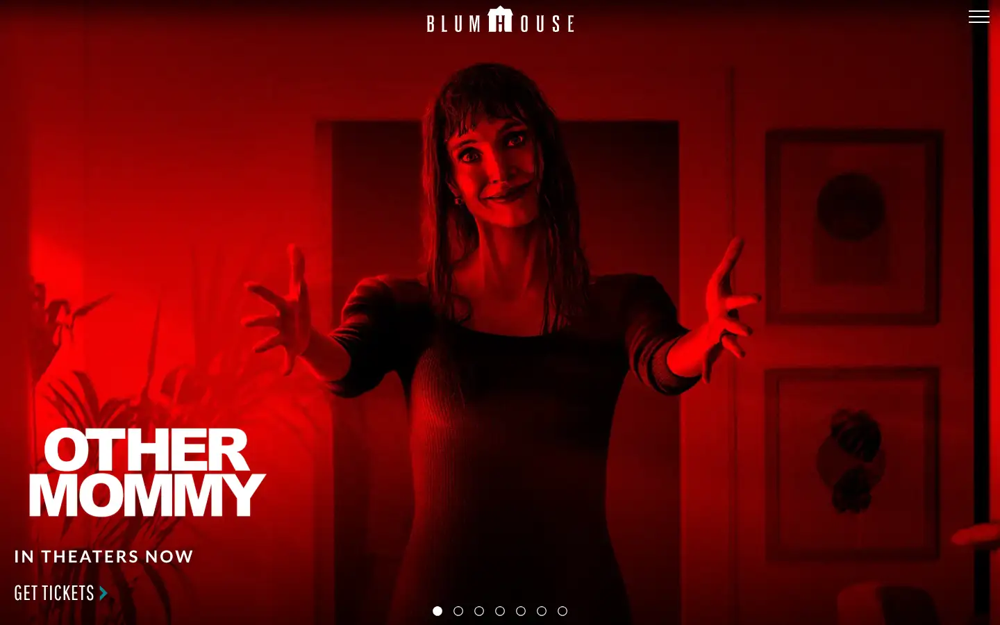
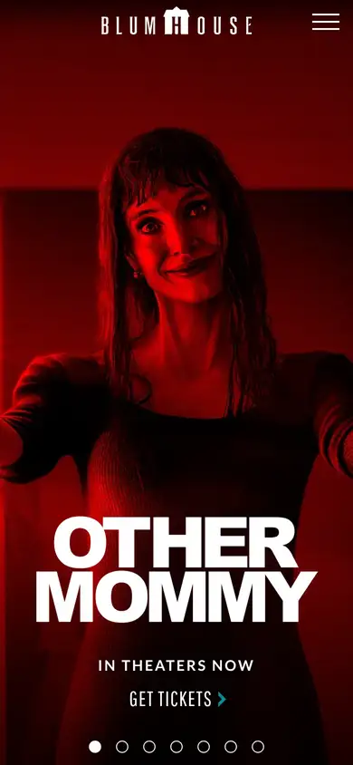

# blumhouse

https://www.blumhouse.com
Tags: lorn, film, dark
Picked because: Blumhouse: horror film studio, dark

## What makes it work
Saturated red light on a horror still with a heavy condensed title.

## Good reference for
Horror-mood heroes.

## Lesson for RUIN-1
Red wash plus condensed type is pure dread: close to the darker LORN tracks.

## Measured (from the live page)
- First screen: dark (average brightness 0.137)
- Background: #1a1a1a; palette by area: #1a1a1a, #252120 at 75%, #101010, #ffffff, #000000 at 60%, #007b7b; accent: #007b7b
- Fonts: Lato, Pathway Gothic One, blumhouse, Arial, Montserrat, Oswald
- Headline: Lato, 27px, weight 700, uppercase, tracking 3px (“NEW MERCH ALERT”)
- Section title: not measured
- Body: Lato, 10px, weight 700 (“© 2026 Blumhouse Productions, LLC. All rights reserved.”)
- Navigation: not measured
- Buttons: “SUBSCRIBE” 54px tall, radius 3px, 22px 500 none
- Section spacing (median vertical padding): 160px; page height 4209px
- Phone: headline 20px, side margin 20px

## Screenshots
 

Whole page: [desktop](desktop-full.webp) · [phone](phone-full.webp)
