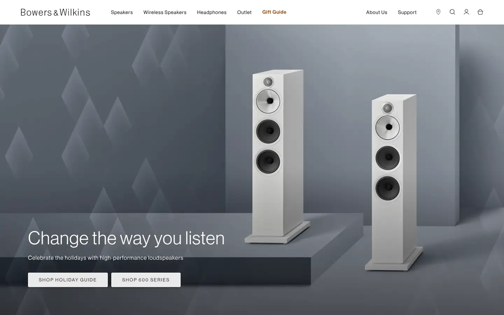
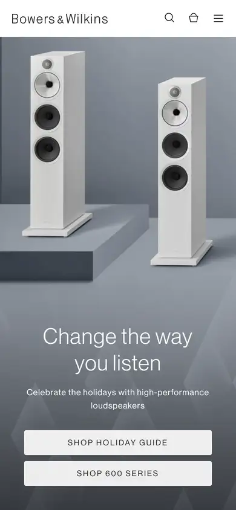

# bowers-wilkins

https://www.bowerswilkins.com/en-us
Tags: product, audio, luxury
Picked because: Bowers & Wilkins: premium audio product pages

## What makes it work
Soft grey studio light, products standing like sculptures, a thin elegant headline.

## Good reference for
Premium audio product pages.

## Lesson for RUIN-1
Calm studio light makes audio gear feel high-end.

## Measured (from the live page)
- First screen: light (average brightness 0.468)
- Background: #efefef; palette by area: #141414 at 60%, #ffffff, #282627, #212529, #9b490f, #c38356; accent: #9b490f
- Fonts: -apple-system, neue-haas-grotesk-display, FontAwesome, Arial, WistiaPlayerInter, Helvetica
- Headline: neue-haas-grotesk-display, 52px, weight 400, tracking 1.12px (“Change the way you listen”)
- Section title: neue-haas-grotesk-display, 20px, weight 400, tracking 1px (“Cart (0)”)
- Body: neue-haas-grotesk-display, 16px, weight 500, tracking 0.8px (“Your cart is currently empty”)
- Navigation: neue-haas-grotesk-display, 14px, weight 500, tracking 0.8px (“Speakers”)
- Buttons: “Skip to main content” 56px tall, radius 0px, 16px 400 none; “Skip to footer content” 56px tall, radius 0px, 16px 400 none; “Speakers” 30px tall, radius 0px, 14px 500 none, border 2px 0px rgba(0, 0, 0, 0); “Wireless Speakers” 30px tall, radius 0px, 14px 500 none, border 2px 0px rgba(0, 0, 0, 0)
- Section spacing (median vertical padding): ?; page height 7691px
- Phone: headline 36px, side margin 410px

## Screenshots
 

Whole page: [desktop](desktop-full.webp) · [phone](phone-full.webp)
