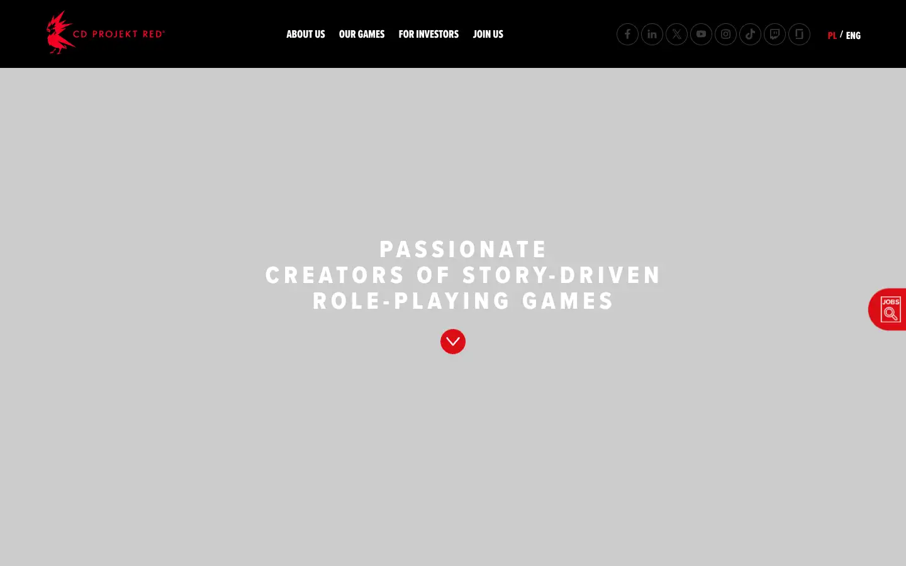
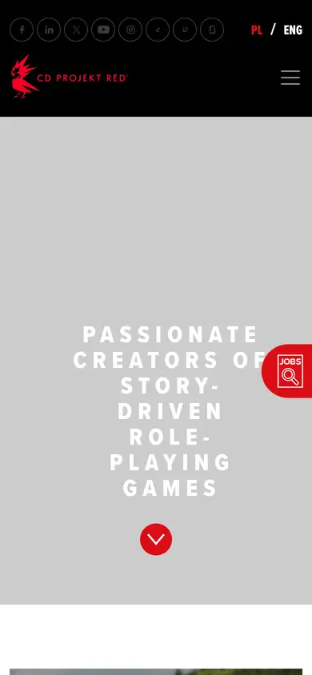

# cd-projekt-red

https://www.cdprojektred.com/en
Tags: games, dark
Picked because: CD Projekt Red: dark, cinematic studio presence

## What makes it work
A grey cinematic field with centred caps and a red accent; corporate yet dark.

## Good reference for
Studio and about pages.

## Lesson for RUIN-1
A single red accent and centred caps hold a corporate page together.

## Measured (from the live page)
- First screen: light (average brightness 0.708)
- Background: #ffffff; palette by area: ?; accent: none
- Fonts: sans-serif
- Headline: Proxima Nova, 32px, weight 500 (“CD PROJEKT RED”)
- Section title: proxima-nova-extra-condensed, 84px, weight 700, uppercase (“BEYOND THE GAME BLOG”)
- Body: Proxima Nova, 15px, weight 400 (“Rebels, dreamers, professionals. Home to over a thousand amb”)
- Navigation: Proxima Nova, 16px, weight 400, uppercase (“checkopen positions”)
- Buttons: “checkopen positions” 67px tall, radius 100px 0px 0px 100px, 16px 400 uppercase; “Our Teams” 50px tall, radius 99px, 17px 800 uppercase, border 2px rgb(219, 13, 21); “Our games” 50px tall, radius 99px, 17px 800 uppercase, border 2px rgb(219, 13, 21); “PERKS & BENEFITS” 50px tall, radius 99px, 17px 800 uppercase, border 2px rgb(219, 13, 21)
- Section spacing (median vertical padding): 80px; page height 4083px
- Phone: headline 32px, side margin 11px

## Screenshots
 

Whole page: [desktop](desktop-full.webp) · [phone](phone-full.webp)
