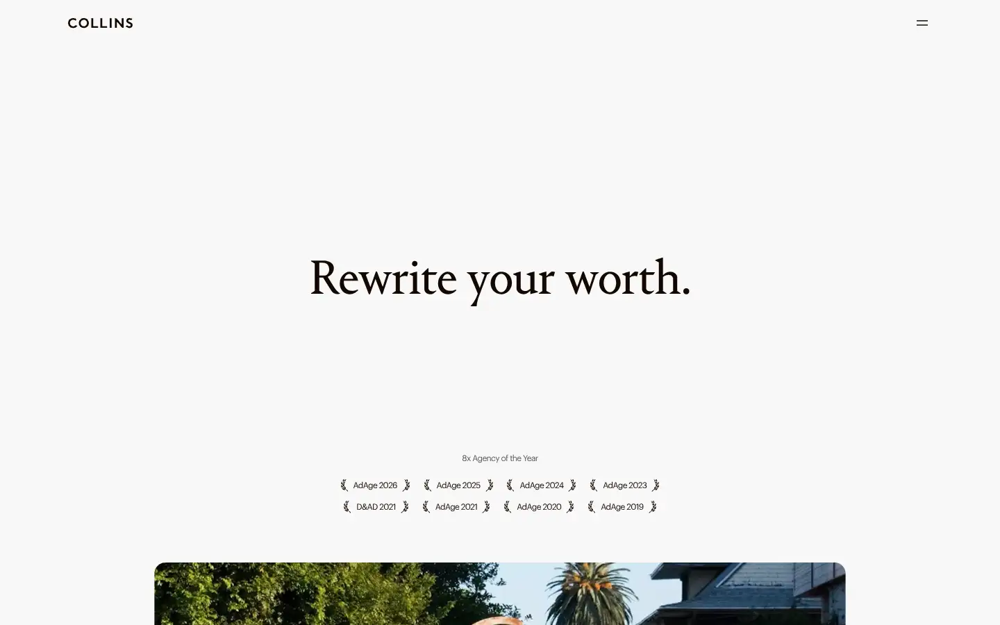
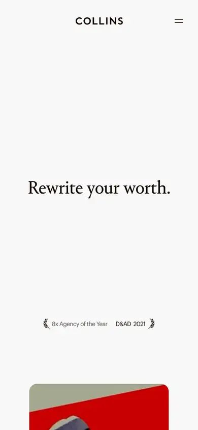

# collins

https://www.wearecollins.com
Tags: studio, type-led, outlier
Picked because: Collins: brand studio with bold, unusual systems

## What makes it work
A single centred serif line on white with lots of air; quiet confidence.

## Good reference for
Statement sections.

## Lesson for RUIN-1
One sentence, beautifully set, is often stronger than a feature list.

## Measured (from the live page)
- First screen: light (average brightness 0.921)
- Background: #cccccc; palette by area: #636247, #cccccc, #efefef, #f8f8f7, #ffffff, #010000 at 40%; accent: #010000 at 40%
- Fonts: COLLINS Graphik Web, Arial, COLLINS Portrait Text Web
- Headline: COLLINS Portrait Text Web, 72px, weight 400, tracking -1.44px (“Rewrite your worth.”)
- Section title: COLLINS Graphik Web, 16px, weight 400, tracking -0.16px (“Programs”)
- Body: COLLINS Graphik Web, 12px, weight 400, tracking -0.64px (“8x Agency of the Year”)
- Navigation: COLLINS Portrait Text Web, 72px, weight 400, tracking -1.44px (“Case Studies”)
- Buttons: “Explore Programs” 45px tall, radius 96px, 14px 400 none, border 1px rgba(0, 0, 0, 0); “Explore” 45px tall, radius 96px, 14px 400 none, border 1px rgba(0, 0, 0, 0); “Explore” 45px tall, radius 96px, 14px 400 none, border 1px rgba(0, 0, 0, 0); “Red Hot x COLLINS” 45px tall, radius 96px, 14px 400 none, border 1px rgba(0, 0, 0, 0)
- Section spacing (median vertical padding): 200px; page height 5402px
- Phone: headline 37px, side margin 24px

## Screenshots
 

Whole page: [desktop](desktop-full.webp) · [phone](phone-full.webp)
