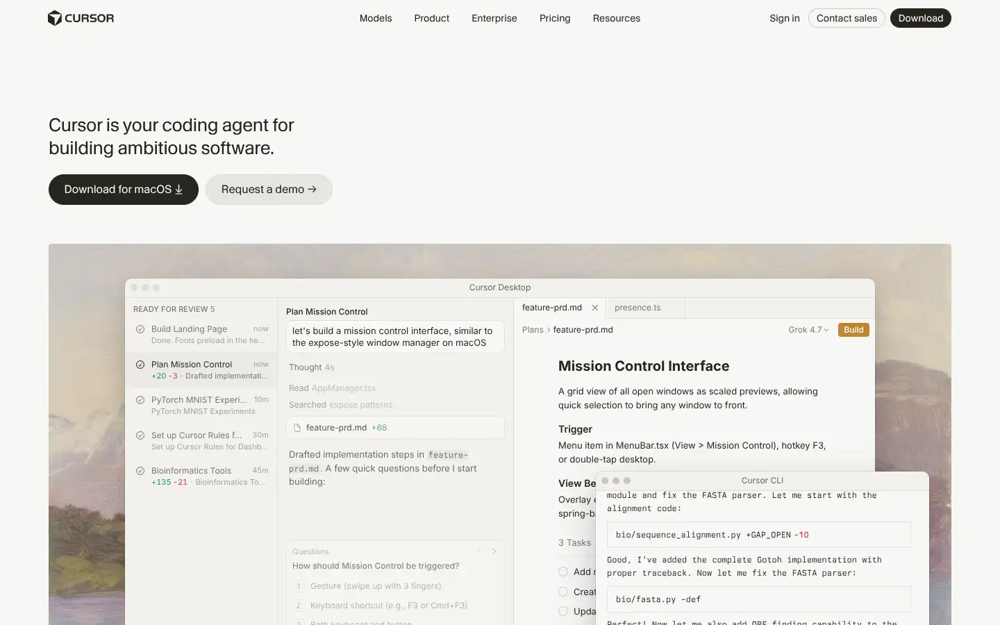
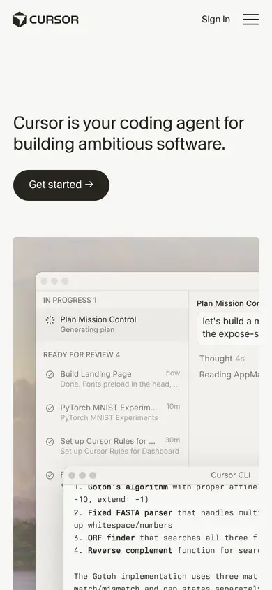

# cursor

https://cursor.com
Tags: software, dark, minimal
Picked because: Cursor: dark minimal product site

## What makes it work
Warm off-white, a calm serif accent, the product window as the image.

## Good reference for
Calm software product pages.

## Lesson for RUIN-1
Even a technical tool can feel warm with a little serif and soft tone.

## Measured (from the live page)
- First screen: light (average brightness 0.909)
- Background: #f7f7f4; palette by area: #f7f7f4, #f2f1ed, #26251e, #d9d5cf, #b6b9be, #000000 at 38%; accent: #101000 at 4%
- Fonts: CursorGothic, system-ui, EB Garamond, berkeleyMono, CursorIcons16, -apple-system
- Headline: CursorGothic, 26px, weight 400, tracking -0.325px (“Cursor is your coding agent for building ambitious software.”)
- Section title: CursorGothic, 14px, weight 400, tracking 0.14px (“Trusted every day by teams that build world-class software”)
- Body: EB Garamond, 17px, weight 400 (“Software creation is changing. We are a group of researchers”)
- Navigation: CursorGothic, 14px, weight 400 (“Skip to content”)
- Buttons: “Models” 34px tall, radius 0px, 14px 400 none, border 1px rgba(0, 0, 0, 0); “Grok” 30px tall, radius 0px, 14px 400 none, border 0px rgb(38, 37, 30); “Evals” 30px tall, radius 0px, 14px 400 none, border 0px rgb(38, 37, 30); “Product” 34px tall, radius 0px, 14px 400 none, border 1px rgba(0, 0, 0, 0)
- Section spacing (median vertical padding): 134px; page height 8199px
- Phone: headline 24px, side margin 19px

## Screenshots
 

Whole page: [desktop](desktop-full.webp) · [phone](phone-full.webp)
