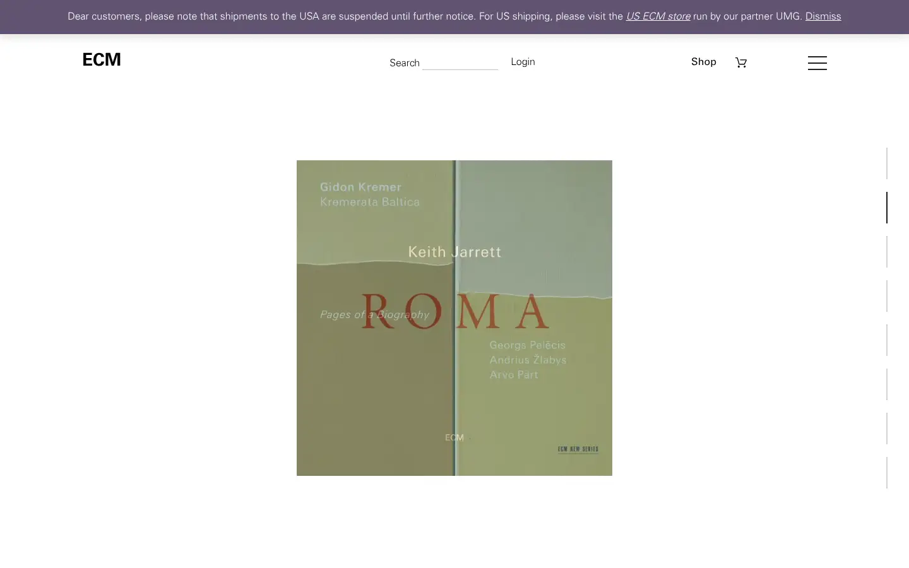

# ecm

https://www.ecmrecords.com
Tags: lorn, music, label, minimal
Picked because: ECM Records: minimal, moody label with a strict visual identity

## What makes it work
Austere: a single album cover centred on white, tiny Univers type, nothing else.

## Good reference for
Single-release focus pages.

## Lesson for RUIN-1
One object, perfectly centred, with almost no chrome: maximum focus.

## Measured (from the live page)
- First screen: light (average brightness 0.876)
- Background: #ffffff; palette by area: #ffffff, #1e1e1e, #615471, #fcfbfe; accent: none
- Fonts: Univers
- Headline: Univers, 79px, weight 300, uppercase (“Out Now”)
- Section title: Univers, 66px, weight 300, uppercase (“News”)
- Body: Univers, 16px, weight 300 (“Dear customers, please note that shipments to the USA are su”)
- Navigation: Univers, 16px, weight 500 (“Shop”)
- Buttons: “CD18,90 €add to cart” 30px tall, radius 0px, 16px 300 none, border 1px 0px rgb(187, 187, 187) rgb(255, 255, 255); “CD18,90 €add to cart” 30px tall, radius 0px, 16px 300 none, border 1px 0px rgb(187, 187, 187) rgb(255, 255, 255); “CD18,90 €add to cart” 30px tall, radius 0px, 16px 300 none, border 1px 0px rgb(187, 187, 187) rgb(255, 255, 255); “CD18,90 €add to cart” 30px tall, radius 0px, 16px 300 none, border 1px 0px rgb(187, 187, 187) rgb(255, 255, 255)
- Section spacing (median vertical padding): ?; page height 7084px
- Phone: headline 32px, side margin 8px

## Screenshots
 

Whole page: [desktop](desktop-full.webp) · [phone](phone-full.webp)
