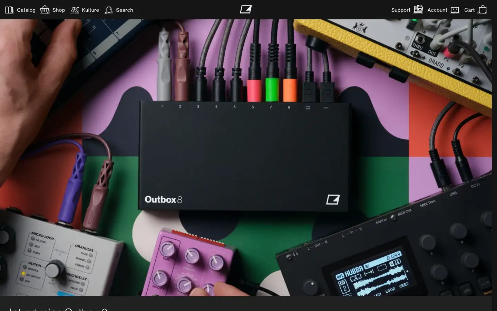
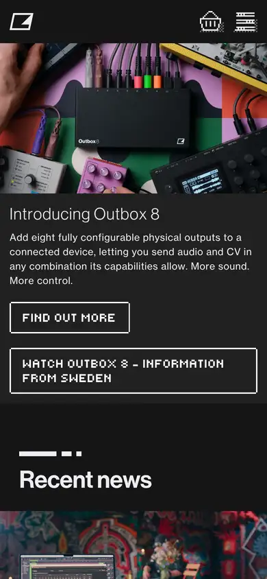

# elektron

https://www.elektron.se
Tags: music, product, synth, dark
Picked because: Elektron: dark, technical, music hardware

## What makes it work
Saturated colour-blocked studio shot of hardware and cables; dark nav; the product among real gear.

## Good reference for
Instrument-in-studio heroes.

## Lesson for RUIN-1
Show RUIN-1 inside a real setup to prove it belongs in one.

## Measured (from the live page)
- First screen: dark (average brightness 0.233)
- Background: #151515; palette by area: #151515, #222222, #eeeef2, #151515 at 10%, #212121, #333337; accent: none
- Fonts: Neue Haas Grotesk Text Pro, digi one v2, Neue Haas Grotesk Display Pro, NHaasGroteskDSPro, ui-monospace
- Headline: Neue Haas Grotesk Display Pro, 31px, weight 400, tracking 1.232px (“Introducing Outbox 8”)
- Section title: Neue Haas Grotesk Display Pro, 64px, weight 500, tracking -0.6405px (“Recent news”)
- Body: Neue Haas Grotesk Text Pro, 14px, weight 400, tracking 0.462px (“Add eight fully configurable physical outputs to a connected”)
- Navigation: Neue Haas Grotesk Text Pro, 14px, weight 400, tracking 0.462px (“.td55fa8ee9-1,.td55fa8ee9-2{fill:#6a6a6e;stroke-width:0}.td5”)
- Buttons: “Skip to content” 34px tall, radius 0px, 14px 700 none; “.td55fa8ee9-1,.td55fa8ee9-2{fi” 36px tall, radius 0px, 24px 450 none, border 0px rgba(0, 0, 0, 0); “.td8c729d61-1,.td8c729d61-2{fi” 36px tall, radius 0px, 24px 450 none, border 0px rgba(0, 0, 0, 0); “.tdbf910753-1 { fill: #6a6a6e;” 36px tall, radius 0px, 24px 450 none, border 0px rgba(0, 0, 0, 0)
- Section spacing (median vertical padding): 42px; page height 6801px
- Phone: headline 24px, side margin 14px

## Screenshots
 

Whole page: [desktop](desktop-full.webp) · [phone](phone-full.webp)
