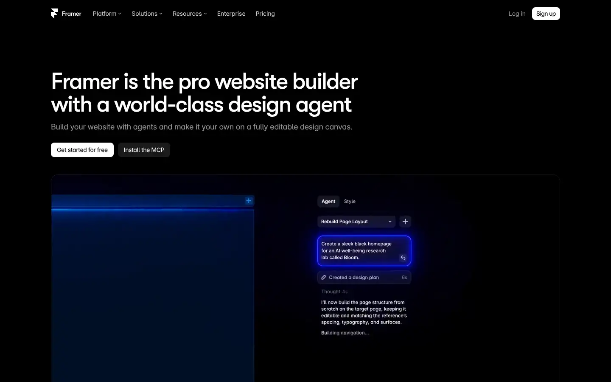
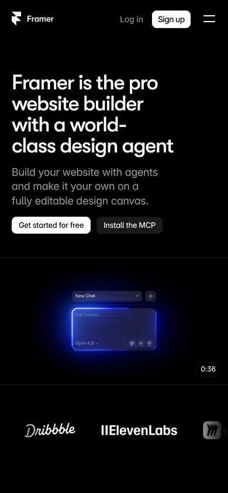

# framer

https://www.framer.com
Tags: software, dark, motion
Picked because: Framer: motion-rich dark marketing site

## What makes it work
Dark page, product UI glowing in blue, short headline, two small buttons.

## Good reference for
Software demos.

## Lesson for RUIN-1
A glowing UI on black (like our pages strip) is exactly the right instinct.

## Measured (from the live page)
- First screen: dark (average brightness 0.04)
- Background: #ffffff at 10%; palette by area: #111111, #171717, #0099ff at 22%, #0099ff at 22%, #ffffff at 15%, #1f1f1f; accent: #0099ff at 22%
- Fonts: sans-serif, Inter Variable, GT Walsheim Medium, Inter, Input Mono Bold, Input Mono Regular
- Headline: GT Walsheim Medium, 54px, weight 500, tracking -2.16px (“Framer is the pro website builder with a world-class design ”)
- Section title: GT Walsheim Medium, 44px, weight 500, tracking -1.76px (“The website builder for shipping standout sites”)
- Body: Inter Variable, 14px, weight 400, tracking -0.01px (“Framer”)
- Navigation: sans-serif, 12px, weight 400 (“Framer”)
- Buttons: “Sign up” 30px tall, radius 8px, 12px 400 none; “Get started for free” 34px tall, radius 8px, 12px 400 none; “Install the MCP” 34px tall, radius 8px, 12px 400 none; “Start with agents” 34px tall, radius 8px, 12px 400 none
- Section spacing (median vertical padding): 240px; page height 12364px
- Phone: headline 36px, side margin 46px

## Screenshots
 

Whole page: [desktop](desktop-full.webp) · [phone](phone-full.webp)
