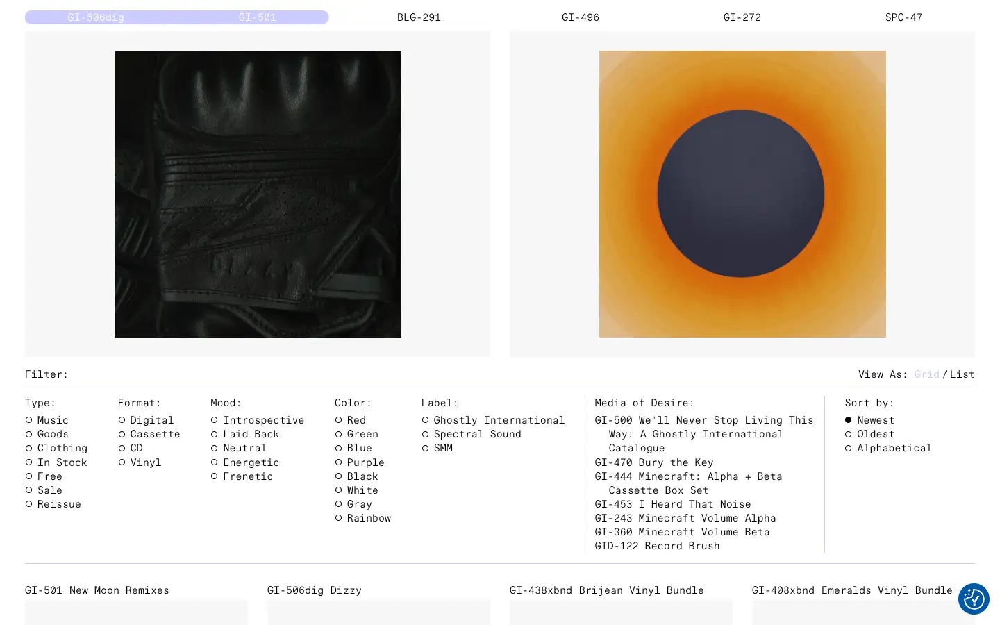
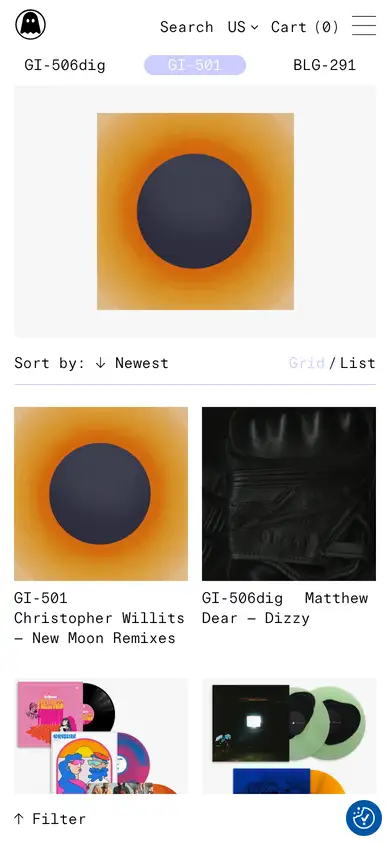

# ghostly

https://ghostly.com
Tags: lorn, music, label
Picked because: Ghostly International: moody, design-led electronic label

## What makes it work
A dense, typographic catalogue: mono labels, serif headings, filters as plain text lists.

## Good reference for
Preset browsers, filter UIs, long lists.

## Lesson for RUIN-1
Mono for data and labels, a softer face for names: a tidy way to show a big preset bank.

## Measured (from the live page)
- First screen: light (average brightness 0.793)
- Background: #0056a7; palette by area: #f7f7f7, #ffffff, #ccccff, #212121, #1863dc, #0056a7; accent: #1863dc
- Fonts: Times New Roman, Lars FS GI Mono, Lars FS GI Light
- Headline: Lars FS GI Light, 19px, weight 400 (“Products”)
- Section title: not measured
- Body: Lars FS GI Light, 14px, weight 400 (“We use cookies to help you navigate efficiently and perform ”)
- Navigation: not measured
- Buttons: “Reject All” 40px tall, radius 0px, 13px 400 none, border 1px rgb(204, 204, 255); “Save My Preferences” 40px tall, radius 0px, 13px 400 none, border 1px rgb(204, 204, 255); “Accept All” 40px tall, radius 0px, 13px 400 none, border 1px rgb(204, 204, 255)
- Section spacing (median vertical padding): 55px; page height 5873px
- Phone: headline 19px, side margin -159px

## Screenshots
 

Whole page: [desktop](desktop-full.webp) · [phone](phone-full.webp)
