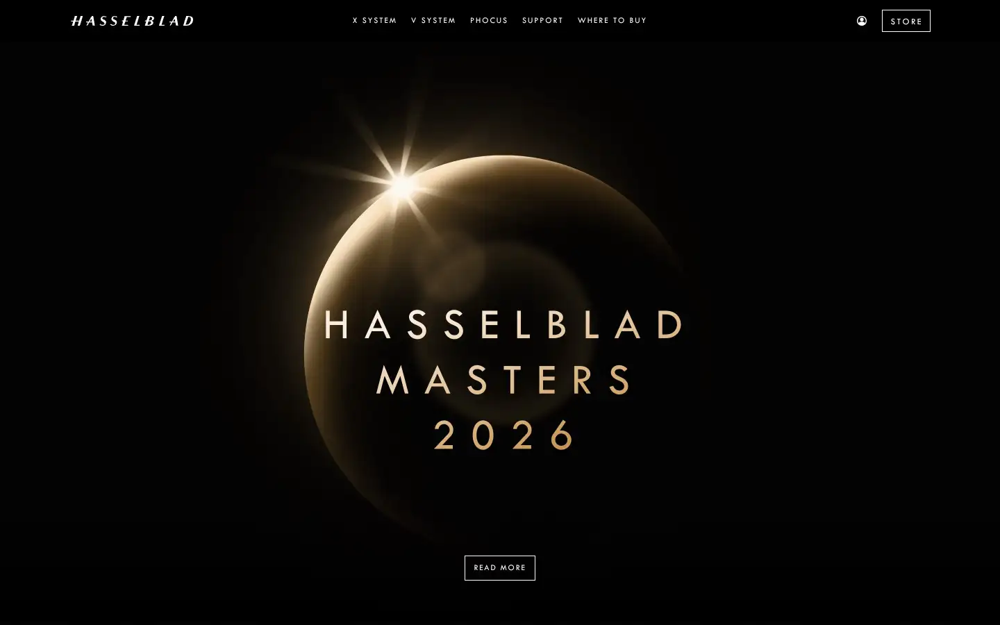
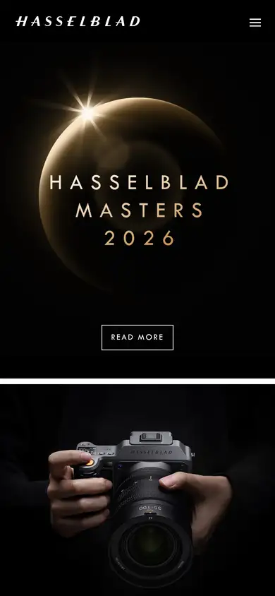

# hasselblad

https://www.hasselblad.com
Tags: lorn, photo, product, dark
Picked because: Hasselblad: dark, premium camera product pages

## What makes it work
A glowing gold ring on pure black with thin, widely tracked caps: a product reveal as an eclipse.

## Good reference for
Launch heroes, light-from-darkness moments.

## Lesson for RUIN-1
Light emerging from black is our safelight idea done perfectly.

## Measured (from the live page)
- First screen: dark (average brightness 0.04)
- Background: #ffffff; palette by area: #ffffff, #ffffff at 65%, #666666, #cb2d2d, #808080; accent: #cb2d2d
- Fonts: outfit, Arial, Tw Cen
- Headline: Tw Cen, 12px, weight 400, uppercase, tracking 2.004px (“X System”)
- Section title: Tw Cen, 22px, weight 400, uppercase, tracking 2px (“BRILLIANCE AT EVERY MOMENT”)
- Body: outfit, 14px, weight 400 (“Sign up for the Hasselblad newsletter to receive the latest ”)
- Navigation: outfit, 14px, weight 400, tracking 0.56px (“X System”)
- Buttons: “Store” 32px tall, radius 0px, 13px 400 uppercase, border 1px rgb(255, 255, 255); “READ MORE” 36px tall, radius 0px, 12px 400 uppercase, border 1px rgb(255, 255, 255); “Read More” 36px tall, radius 0px, 12px 400 uppercase, border 1px rgb(255, 255, 255); “Buy Now” 36px tall, radius 0px, 12px 400 uppercase, border 1px rgb(255, 255, 255)
- Section spacing (median vertical padding): 96px; page height 6028px
- Phone: headline 30px, side margin 68px

## Screenshots
 

Whole page: [desktop](desktop-full.webp) · [phone](phone-full.webp)
