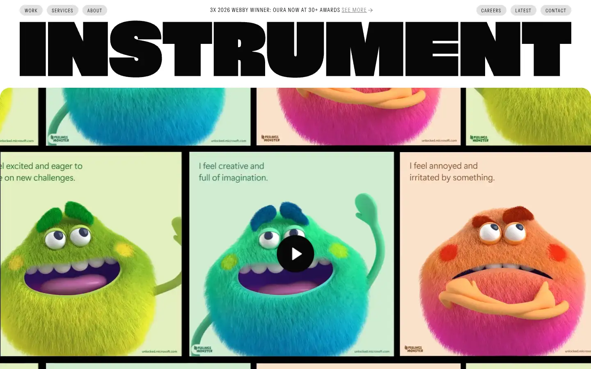
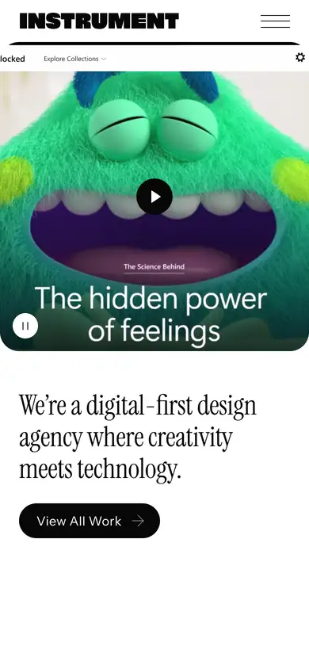

# instrument

https://www.instrument.com
Tags: studio, motion
Picked because: Instrument: top digital studio, polished motion

## What makes it work
Huge black condensed wordmark over a grid of playful 3D characters.

## Good reference for
Bold wordmark headers, grids.

## Lesson for RUIN-1
A giant wordmark band can anchor a page: a cousin of mobile pitch 6D.

## Measured (from the live page)
- First screen: light (average brightness 0.604)
- Background: #070708; palette by area: #e8e8e9, #070708, #e8e8e9 at 12%, #070708 at 50%, #808080, #e8e8e9 at 50%; accent: none
- Fonts: Instrument-Sans, Instrument-Serif
- Headline: Instrument-Sans, 12px, weight 400, uppercase, tracking 1.32px (“Recent work”)
- Section title: Instrument-Sans, 12px, weight 400, uppercase, tracking 1.32px (“Recent work”)
- Body: Instrument-Sans, 14px, weight 400, uppercase, tracking 1.12px (“Meet Playspace: Instrument's archive of creative experiments”)
- Navigation: Instrument-Sans, 16px, weight 400 (“Skip Navigation”)
- Buttons: “Skip Navigation” 50px tall, radius 0px, 16px 400 none
- Section spacing (median vertical padding): 12px; page height 6710px
- Phone: headline ?, side margin 24px

## Screenshots
 

Whole page: [desktop](desktop-full.webp) · [phone](phone-full.webp)
