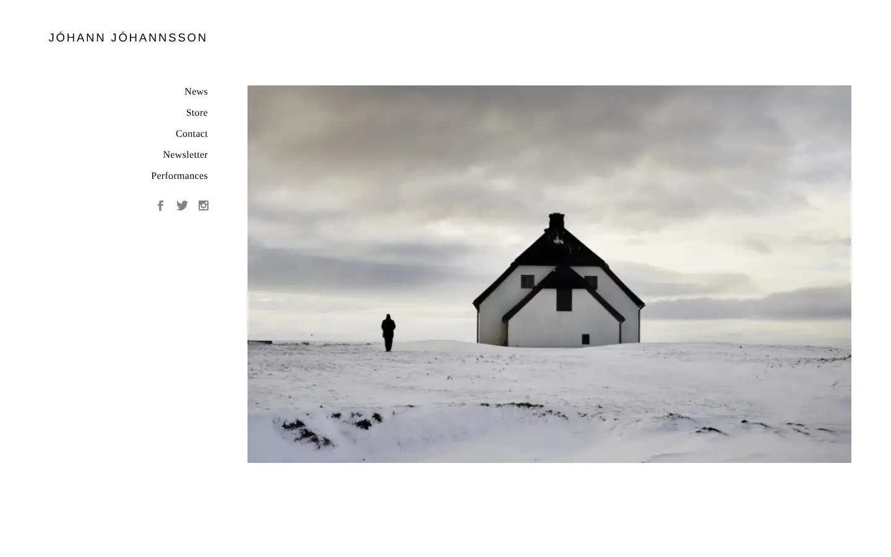
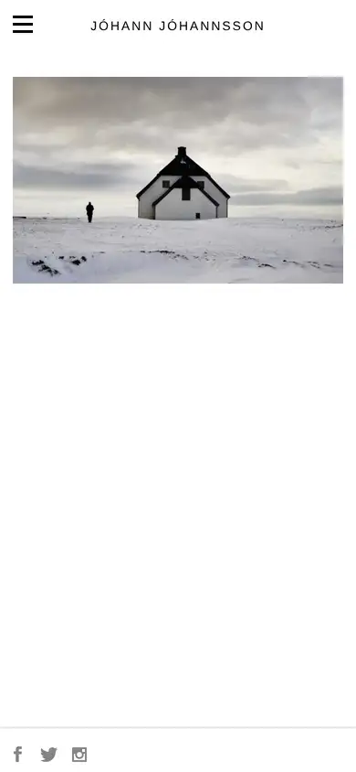

# johann-johannsson

https://www.johannjohannsson.com
Tags: lorn, score, dark
Picked because: Jóhann Jóhannsson: cinematic score composer, quiet and dark

## What makes it work
A single quiet photograph, a tiny serif name, enormous white space: grief and stillness.

## Good reference for
Calm about or story sections.

## Lesson for RUIN-1
Stillness is a design tool: give one image room and say almost nothing.

## Measured (from the live page)
- First screen: light (average brightness 0.858)
- Background: #ffffff; palette by area: #ffffff; accent: none
- Fonts: Open Sans, Georgia
- Headline: Open Sans, 32px, weight 400, tracking 0.16px (“Jóhann Jóhannsson”)
- Section title: not measured
- Body: not measured
- Navigation: Open Sans, 19px, weight 400, uppercase, tracking 2.784px (“Jóhann Jóhannsson”)
- Buttons: none found
- Section spacing (median vertical padding): ?; page height 900px
- Phone: headline 24px, side margin 7px

## Screenshots
 

Whole page: [desktop](desktop-full.webp) · [phone](phone-full.webp)
