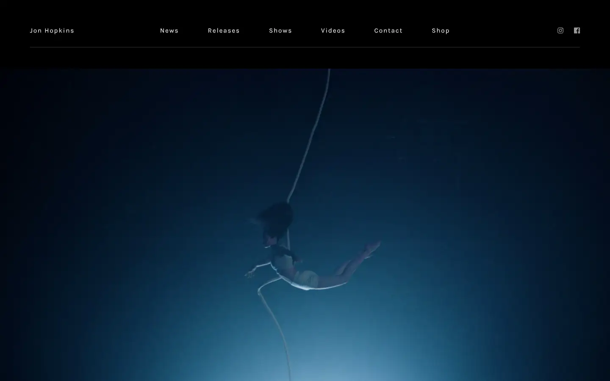
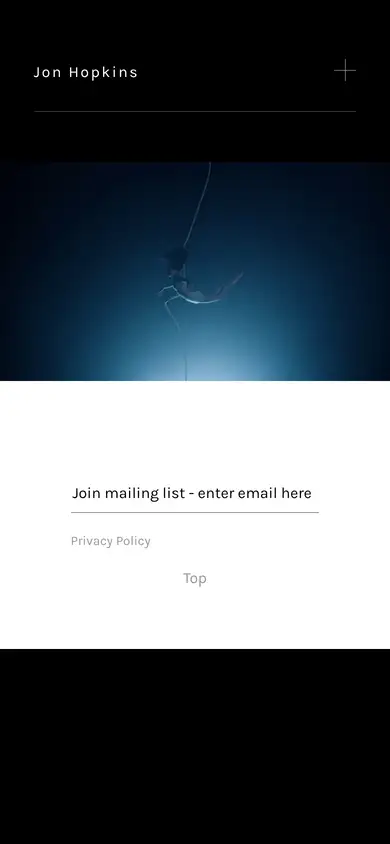

# jon-hopkins

https://www.jonhopkins.co.uk
Tags: lorn, music, analog
Picked because: Jon Hopkins: cinematic electronic artist

## What makes it work
Deep blue darkness with one small figure; a tiny nav floating on top; huge negative space.

## Good reference for
Atmospheric openers, scroll-in moments.

## Lesson for RUIN-1
Scale contrast (a tiny subject in a big dark space) creates awe cheaply.

## Measured (from the live page)
- First screen: dark (average brightness 0.107)
- Background: #ffffff at 80%; palette by area: #ffffff, #999999; accent: none
- Fonts: Karla
- Headline: not measured
- Section title: not measured
- Body: not measured
- Navigation: Karla, 15px, weight 400, tracking 1.8px (“Jon Hopkins”)
- Buttons: none found
- Section spacing (median vertical padding): ?; page height 1201px
- Phone: headline ?, side margin 0px

## Screenshots
 

Whole page: [desktop](desktop-full.webp) · [phone](phone-full.webp)
