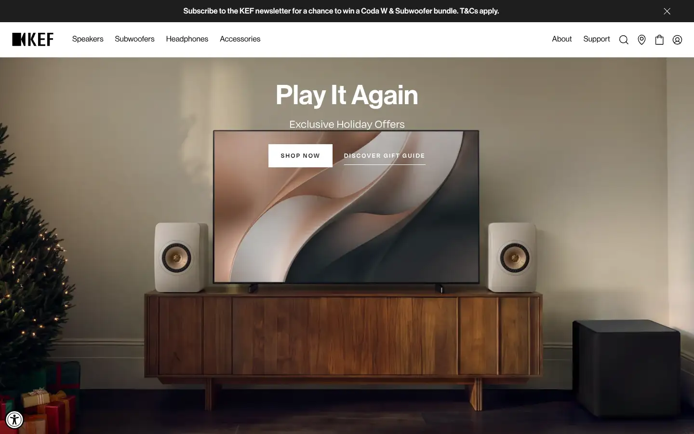
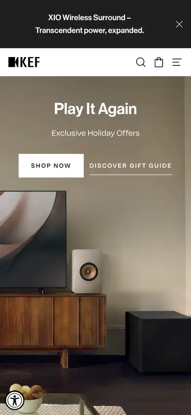

# kef

https://us.kef.com
Tags: product, audio
Picked because: KEF: high-end speakers, product craft

## What makes it work
A lifestyle room scene with the product in place, a centred title and two buttons.

## Good reference for
In-context product shots.

## Lesson for RUIN-1
Showing the synth in a dark studio scene could sell the mood fast.

## Measured (from the live page)
- First screen: light (average brightness 0.405)
- Background: #ffffff; palette by area: #ffffff, #fafafa, #000000 at 50%, #1f1e1e, #e2e2e2, #000000 at 4%; accent: none
- Fonts: accessibly, Noto Sans, sans-serif, Degular, Neue Haas Grotesk Display Pro
- Headline: Neue Haas Grotesk Display Pro, 40px, weight 500 (“Popular Products”)
- Section title: Neue Haas Grotesk Display Pro, 40px, weight 500 (“Popular Products”)
- Body: Neue Haas Grotesk Display Pro, 16px, weight 600 (“Find A Dealer”)
- Navigation: Neue Haas Grotesk Display Pro, 16px, weight 500 (“Speakers”)
- Buttons: “Shop now” 48px tall, radius 0px, 14px 600 uppercase, border 1px rgb(255, 255, 255); “Sign up now” 50px tall, radius 0px, 14px 500 uppercase, border 1px rgb(31, 30, 30)
- Section spacing (median vertical padding): 96px; page height 7647px
- Phone: headline ?, side margin 60px

## Screenshots
 

Whole page: [desktop](desktop-full.webp) · [phone](phone-full.webp)
