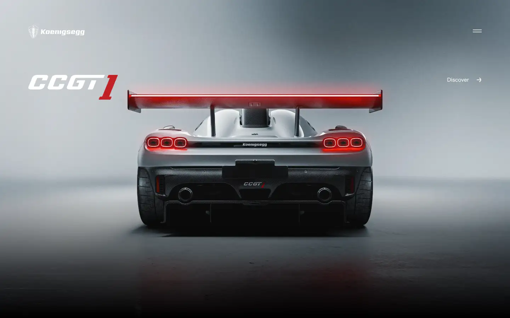
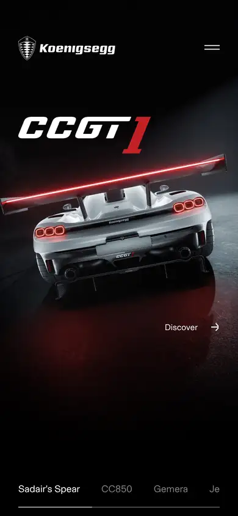

# koenigsegg

https://www.koenigsegg.com
Tags: product, luxury, dark, hero
Picked because: Koenigsegg: dark, cinematic hypercar presentation

## What makes it work
A machine shot from behind under cold light, a huge brand-script title, almost no UI.

## Good reference for
Dramatic product reveals.

## Lesson for RUIN-1
A single dramatic angle and one huge title can carry a first screen.

## Measured (from the live page)
- First screen: light (average brightness 0.443)
- Background: #687c7b; palette by area: #ffffff, #687c7b; accent: none
- Fonts: Basel Grotesk, Gustavo
- Headline: Basel Grotesk, 32px, weight 700 (“In-house Innovations”)
- Section title: Basel Grotesk, 24px, weight 700 (“The Show Must Go On”)
- Body: Basel Grotesk, 16px, weight 400 (“Staying ahead of the curve in a very competitive e-mobility ”)
- Navigation: Basel Grotesk, 16px, weight 400 (“Megacars”)
- Buttons: none found
- Section spacing (median vertical padding): 280px; page height 5378px
- Phone: headline 32px, side margin 30px

## Screenshots
 

Whole page: [desktop](desktop-full.webp) · [phone](phone-full.webp)
