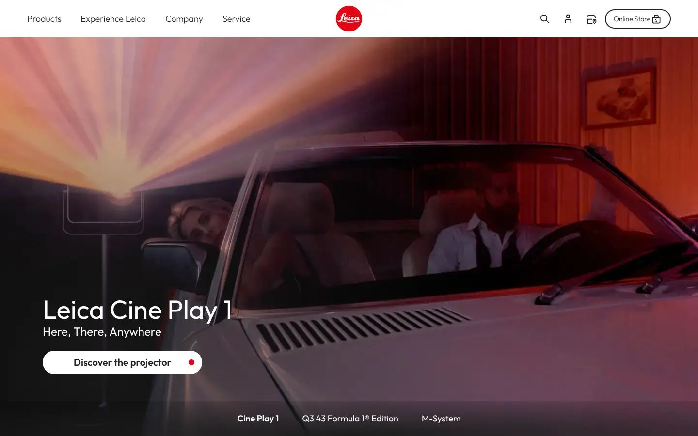
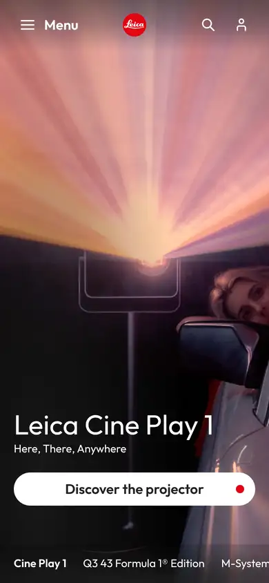

# leica

https://leica-camera.com/en-US
Tags: product, photo
Picked because: Leica: heritage craft, restrained luxury

## What makes it work
Warm cinematic photography with a clean white headline and one white pill; a quiet tab row at the bottom.

## Good reference for
Heroes with sub-navigation.

## Lesson for RUIN-1
A bottom row of product tabs under the hero is a neat way to jump between pages.

## Measured (from the live page)
- First screen: dark (average brightness 0.299)
- Background: #ffffff; palette by area: #ffffff, #222222; accent: none
- Fonts: Outfit
- Headline: Outfit, 54px, weight 400 (“Leica Cine Play 1”)
- Section title: Outfit, 54px, weight 400 (“Leica Cine Play 1”)
- Body: Outfit, 54px, weight 400 (“Leica Cine Play 1”)
- Navigation: Outfit, 18px, weight 300 (“Products”)
- Buttons: “Products” 76px tall, radius 0px, 18px 300 none, border 0px rgb(34, 34, 34); “Experience Leica” 76px tall, radius 0px, 18px 300 none, border 0px rgb(34, 34, 34); “Company” 76px tall, radius 0px, 18px 300 none, border 0px rgb(34, 34, 34); “Service” 76px tall, radius 0px, 18px 300 none, border 0px rgb(34, 34, 34)
- Section spacing (median vertical padding): 20px; page height 14943px
- Phone: headline ?, side margin 20px

## Screenshots
 

Whole page: [desktop](desktop-full.webp) · [phone](phone-full.webp)
