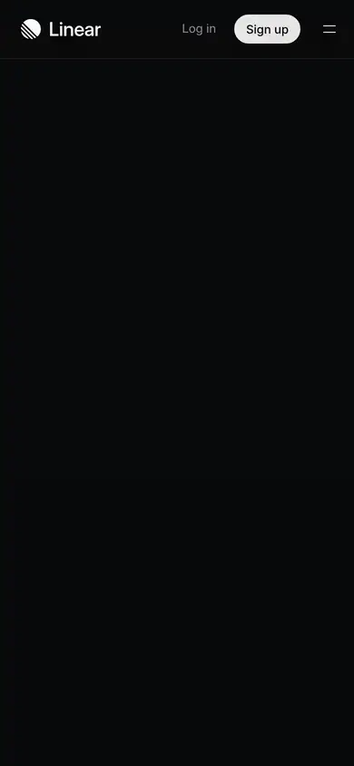

# linear

https://linear.app
Tags: software, dark, type-led, motion
Picked because: Linear: the reference for dark, precise software design

## What makes it work
Near-black, precise Inter type with tight tracking, the product UI as the hero image.

## Good reference for
Dark software heroes, UI showcases.

## Lesson for RUIN-1
Show the real interface big, framed in near-black, with tight confident type.

## Measured (from the live page)
- First screen: dark (average brightness 0.09)
- Background: #08090a; palette by area: #08090a, #0f1011, #f7f8f8, #090a0b, #101112, #ffffff at 1%; accent: #e4f222
- Fonts: Inter Variable, Berkeley Mono
- Headline: Inter Variable, 64px, weight 510, tracking -1.408px (“The product development system for teams and agentsThe produ”)
- Section title: Inter Variable, 48px, weight 510, tracking -1.056px (“A new species of product tool. Purpose-built for modern team”)
- Body: Inter Variable, 15px, weight 400, tracking -0.165px (“Purpose-built for planning and building products. Designed f”)
- Navigation: Inter Variable, 13px, weight 400 (“Customers”)
- Buttons: “Skip to content →” 32px tall, radius 0px, 14px 510 none; “Sign up” 32px tall, radius 9999px, 13px 510 none, border 1px rgb(229, 229, 230); “Get started” 44px tall, radius 9999px, 16px 510 none, border 1px rgb(229, 229, 230); “Contact sales” 44px tall, radius 9999px, 16px 510 none
- Section spacing (median vertical padding): 256px; page height 9990px
- Phone: headline ?, side margin ?px

## Screenshots
 

Whole page: [desktop](desktop-full.webp) · [phone](phone-full.webp)
