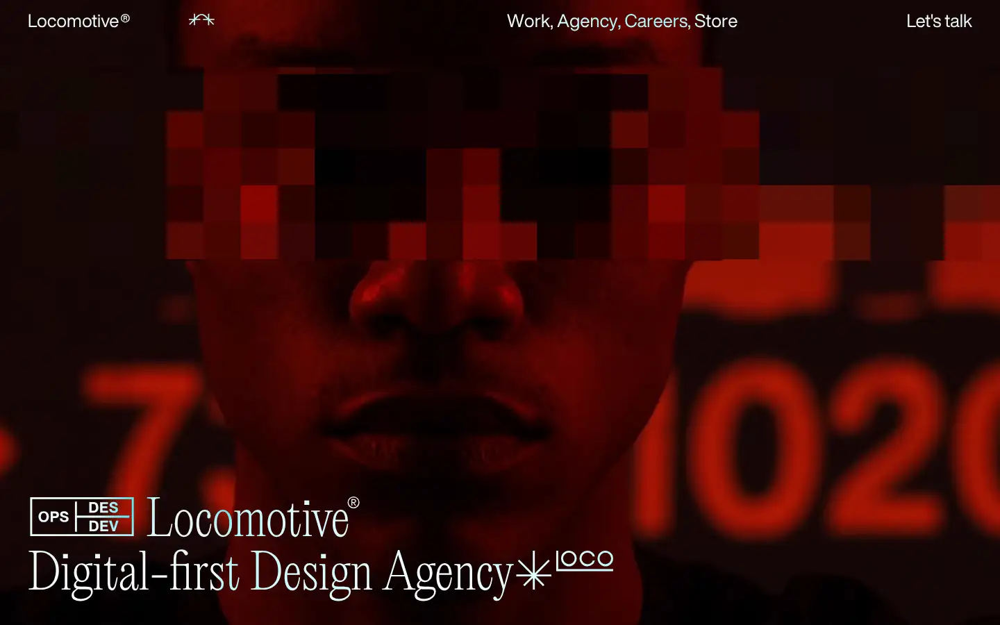
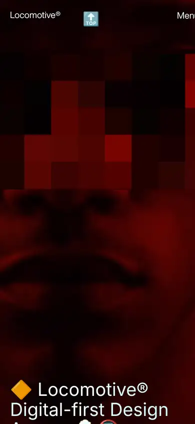

# locomotive

https://locomotive.ca/en
Tags: studio, motion, type-led
Picked because: Locomotive: smooth-scroll craft, editorial type

## What makes it work
Pixelated, red, glitchy portrait with a grotesk-plus-serif lockup; very editorial.

## Good reference for
Glitch and decayed-signal moments.

## Lesson for RUIN-1
A pixel/decay effect in red is close to our decayed-signal header.

## Measured (from the live page)
- First screen: dark (average brightness 0.082)
- Background: #ffffff; palette by area: #ffffff; accent: none
- Fonts: HelveticaNowDisplay, LocomotiveNew
- Headline: LocomotiveNew, 70px, weight 400 (“🔶 Locomotive® Digital-first Design Agency🍺🔞”)
- Section title: HelveticaNowDisplay, 26px, weight 400 (“Featured work”)
- Body: HelveticaNowDisplay, 26px, weight 400 (“Seven Years Running 2018-2024”)
- Navigation: HelveticaNowDisplay, 26px, weight 400 (“Locomotive®”)
- Buttons: “The dynasty” 48px tall, radius 0px, 26px 400 none, border 2px 0px 0px rgb(0, 0, 0); “Agency” 48px tall, radius 0px, 26px 400 none, border 2px 0px 0px rgb(0, 0, 0); “Careers” 48px tall, radius 0px, 26px 400 none, border 2px 0px 0px rgb(0, 0, 0)
- Section spacing (median vertical padding): 7px; page height 6598px
- Phone: headline 36px, side margin 20px

## Screenshots
 

Whole page: [desktop](desktop-full.webp) · [phone](phone-full.webp)
