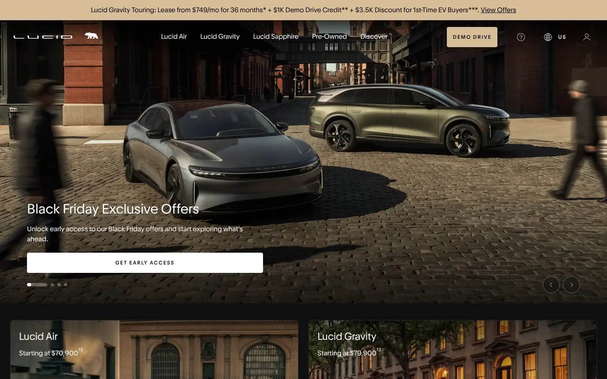
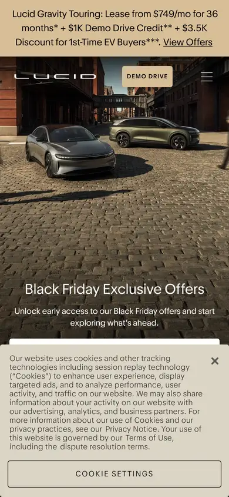

# lucid

https://lucidmotors.com
Tags: product, luxury, hero
Picked because: Lucid: luxury product storytelling

## What makes it work
Warm evening photography, a serif-tinged wordmark, a white button floating on the image.

## Good reference for
Luxury heroes with offers.

## Lesson for RUIN-1
Golden-hour warmth against dark tones is a luxury signal.

## Measured (from the live page)
- First screen: dark (average brightness 0.245)
- Background: #0f0f0f; palette by area: #0f0f0f, #f0f0f0, #333333, #ffffff, #323232, #d7be96; accent: #0000ee
- Fonts: Times New Roman, Lucid Sans VF, Arial, Lucid Serif VF, Lucid Serif Italic VF, GTAmerica
- Headline: Lucid Serif VF, 72px, weight 400, tracking -0.5px (“More of What Matters”)
- Section title: Lucid Serif VF, 64px, weight 400, tracking -0.5px (“Keep exploring”)
- Body: Lucid Sans VF, 16px, weight 400 (“Lucid Gravity Touring: Lease from $749/mo for 36 months* + $”)
- Navigation: Times New Roman, 16px, weight 400 (“Lucid Gravity Touring: Lease from $749/mo for 36 months* + $”)
- Buttons: “Skip to main content” 48px tall, radius 4px, 16px 400 none; “Lucid Gravity Touring: Lease f” 48px tall, radius 0px, 16px 400 none; “DEMO DRIVE” 48px tall, radius 4px, 16px 400 none; “Find Out” 48px tall, radius 4px, 16px 400 none
- Section spacing (median vertical padding): 136px; page height 6258px
- Phone: headline ?, side margin ?px

## Screenshots
 

Whole page: [desktop](desktop-full.webp) · [phone](phone-full.webp)
