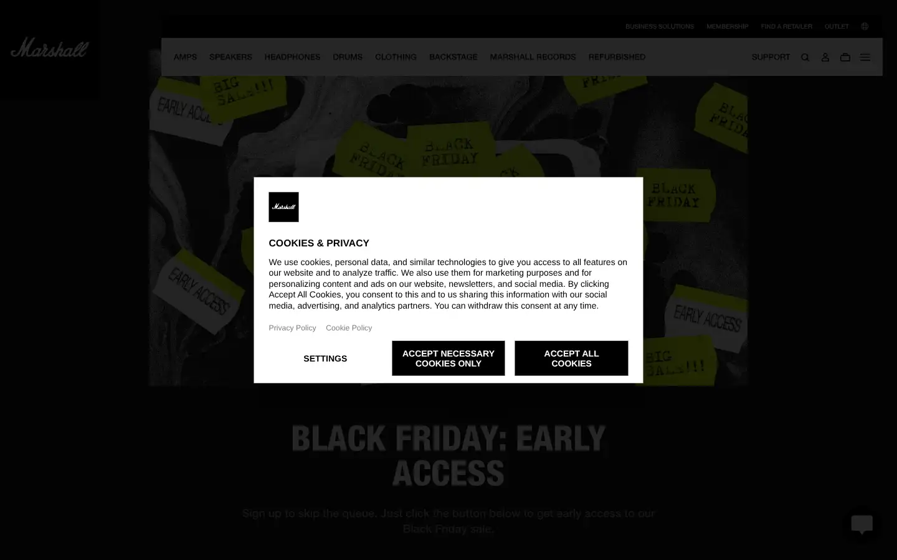
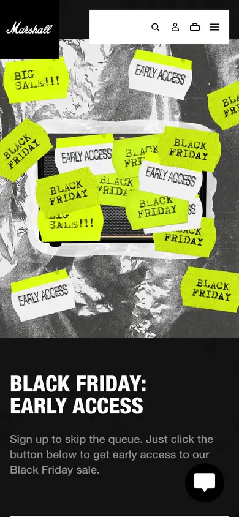

# marshall

https://www.marshall.com/us/en
Tags: product, audio, music
Picked because: Marshall: music gear brand with character and texture

## What makes it work
Heavy condensed caps, gritty textures, music-gear attitude. (The consent box could not be dismissed in capture.)

## Good reference for
Music gear with character.

## Lesson for RUIN-1
Grit and weight in the type can carry the brand's sound.

## Measured (from the live page)
- First screen: dark (average brightness 0.168)
- Background: #000000 at 60%; palette by area: #333333, #ffffff, #8c8c8c, #1a1a1a, #595959, #000000 at 35%; accent: none
- Fonts: NeueHelvetica, NeueHelveticaPaneuropean
- Headline: NeueHelveticaPaneuropean, 56px, weight 800, uppercase (“BLACK FRIDAY: EARLY ACCESS”)
- Section title: NeueHelveticaPaneuropean, 56px, weight 800, uppercase (“BLACK FRIDAY: EARLY ACCESS”)
- Body: NeueHelvetica, 18px, weight 500 (“Sign up to skip the queue. Just click the button below to ge”)
- Navigation: NeueHelvetica, 13px, weight 500, uppercase (“AmpsAmps”)
- Buttons: “Business solutions” 38px tall, radius 0px, 10px 500 uppercase, border 0px rgb(226, 232, 240); “Membership” 38px tall, radius 0px, 10px 500 uppercase, border 0px rgb(226, 232, 240); “Find a retailer” 38px tall, radius 0px, 10px 500 uppercase, border 0px rgb(226, 232, 240); “Outlet” 38px tall, radius 0px, 10px 500 uppercase, border 0px rgb(226, 232, 240)
- Section spacing (median vertical padding): ?; page height 9595px
- Phone: headline ?, side margin 16px

## Screenshots
 

Whole page: [desktop](desktop-full.webp) · [phone](phone-full.webp)
