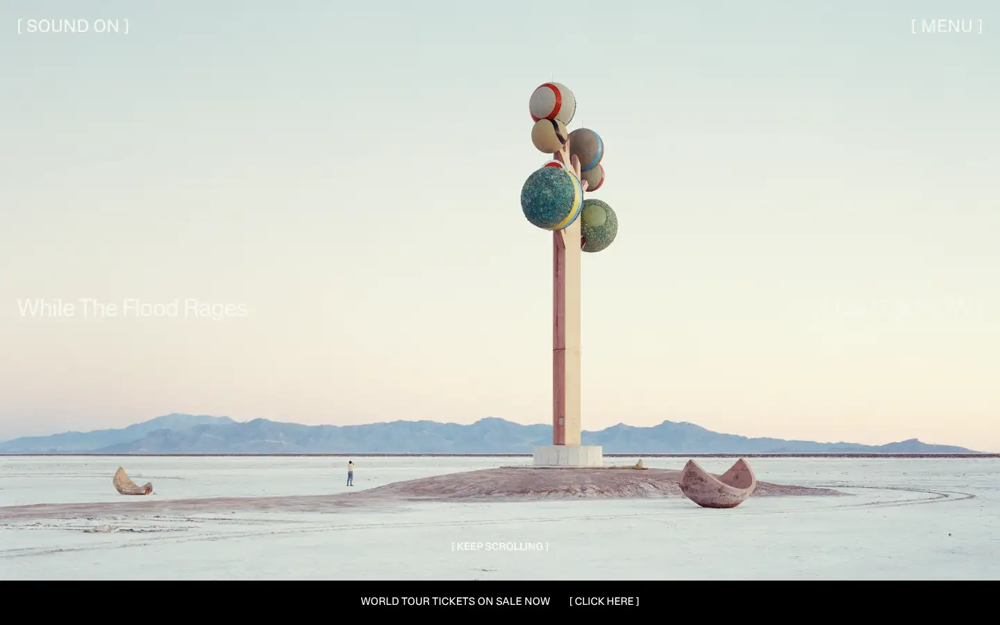
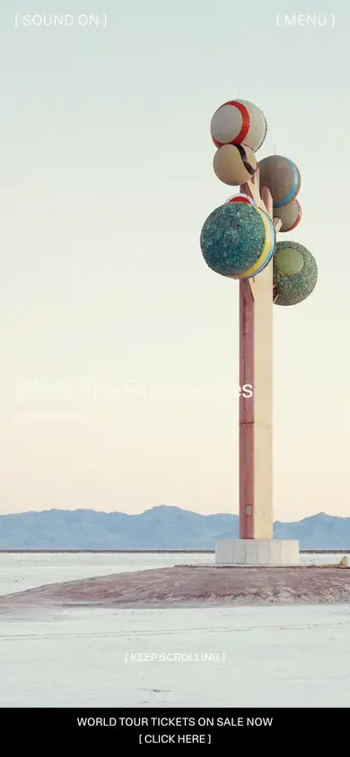

# max-richter

https://www.maxrichtermusic.com
Tags: lorn, score, cinematic
Picked because: Max Richter: cinematic score composer, quiet and grand

## What makes it work
A surreal full-bleed still, a light-weight sans with tight tracking, a thin ticket bar at the bottom.

## Good reference for
Cinematic heroes with a single announcement.

## Lesson for RUIN-1
A dream-like image plus one quiet line feels expensive; avoid stacking buttons on it.

## Measured (from the live page)
- First screen: light (average brightness 0.798)
- Background: #000000 at 25%; palette by area: #000000 at 25%, #c6c6bf at 60%, #f7f7ef, #ffffff; accent: none
- Fonts: Lateral Regular, Lateral Medium
- Headline: Lateral Regular, 35px, weight 400, tracking -1.05px (“Max Richter”)
- Section title: not measured
- Body: not measured
- Navigation: Lateral Regular, 35px, weight 400, uppercase, tracking -0.7px (“Info”)
- Buttons: none found
- Section spacing (median vertical padding): ?; page height 11700px
- Phone: headline 28px, side margin 124px

## Screenshots
 

Whole page: [desktop](desktop-full.webp) · [phone](phone-full.webp)
