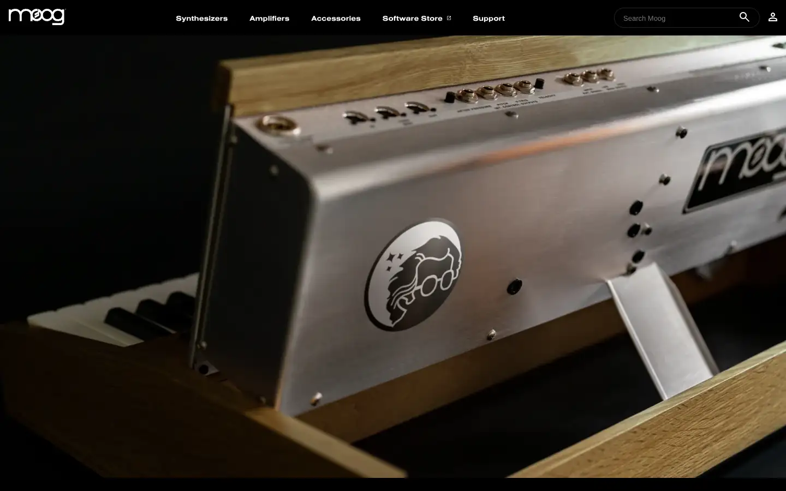
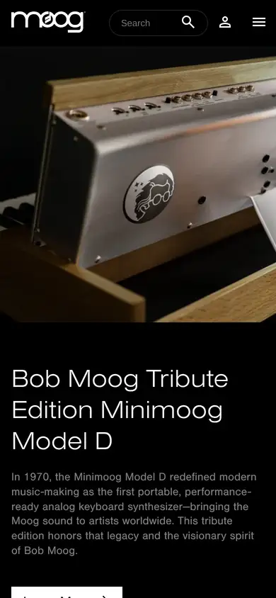

# moog

https://www.moogmusic.com
Tags: lorn, synth, analog, product
Picked because: Moog: analog synth maker, instrument-as-object

## What makes it work
A close, warmly lit macro shot of real hardware; dark nav, the instrument as a precious object.

## Good reference for
Instrument product pages.

## Lesson for RUIN-1
Shoot (or render) the synth like an object under one warm light.

## Measured (from the live page)
- First screen: dark (average brightness 0.229)
- Background: #000000 at 90%; palette by area: #ffffff, #000000 at 90%, #808080, #fcb040; accent: #fcb040
- Fonts: nimbus-sans-extended, Arial, nimbus-sans, Source Sans Pro
- Headline: not measured
- Section title: not measured
- Body: nimbus-sans, 13px, weight 400, capitalize (“A new method of sonic experimentation, communication, and co”)
- Navigation: nimbus-sans-extended, 13px, weight 700 (“Synthesizers”)
- Buttons: none found
- Section spacing (median vertical padding): ?; page height 9380px
- Phone: headline ?, side margin 490px

## Screenshots
 

Whole page: [desktop](desktop-full.webp) · [phone](phone-full.webp)
