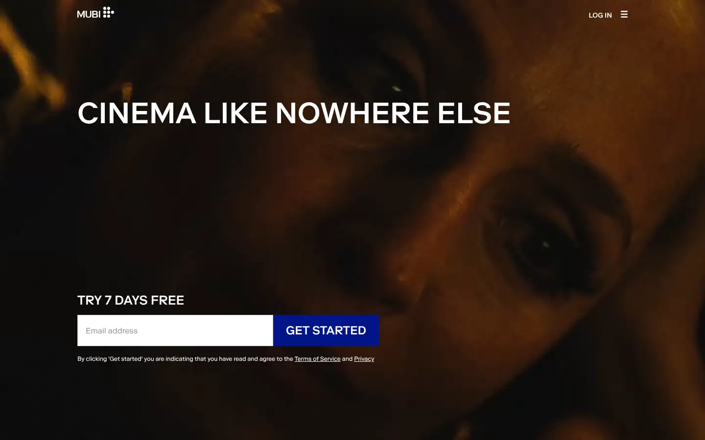
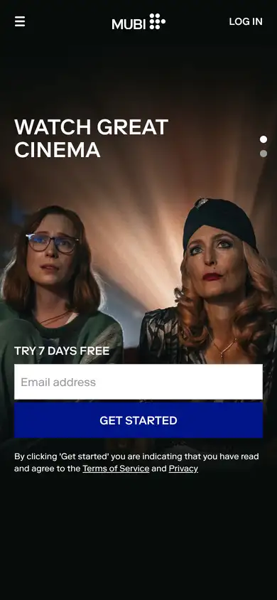

# mubi

https://mubi.com/en/us
Tags: lorn, film, dark, type-led
Picked because: MUBI: cinematic, curated film platform with editorial type

## What makes it work
Dark, intimate film still, a big uppercase line and one email field with a solid button.

## Good reference for
Sign-up and trial heroes.

## Lesson for RUIN-1
One clear action on a moody image: a template for a 'Get the free trial' hero.

## Measured (from the live page)
- First screen: dark (average brightness 0.126)
- Background: #ffffff; palette by area: #ffffff, #eaeaea, #2d2420, #ff4238, #001489, #7d7d7d; accent: #ff4238
- Fonts: Riforma
- Headline: Riforma, 60px, weight 500, uppercase (“watch great cinemacinema like nowhere else”)
- Section title: Riforma, 26px, weight 500, uppercase (“Try 7 Days Free”)
- Body: Riforma, 14px, weight 400 (“At MUBI, we do not sell your personal data for monetary valu”)
- Navigation: not measured
- Buttons: “Cancel” 42px tall, radius 2px, 14px 500 none, border 1px rgb(222, 223, 224); “Save My Preferences” 42px tall, radius 2px, 14px 500 none, border 1px rgb(0, 20, 137); “Get started” 64px tall, radius 0px, 24px 500 uppercase, border 1px rgb(0, 20, 137); “Get started” 64px tall, radius 0px, 24px 500 uppercase, border 1px rgb(0, 20, 137)
- Section spacing (median vertical padding): ?; page height 4376px
- Phone: headline 60px, side margin -171px

## Screenshots
 

Whole page: [desktop](desktop-full.webp) · [phone](phone-full.webp)
