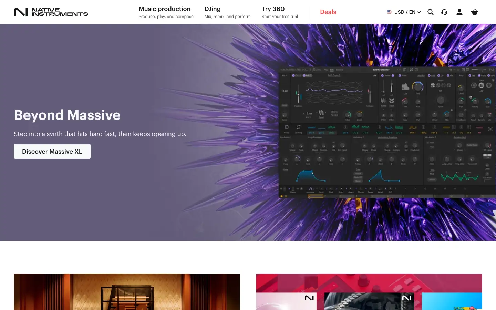
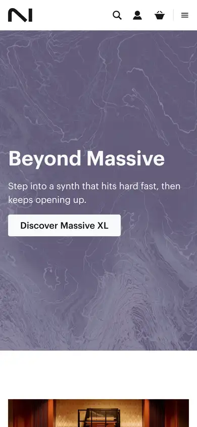

# native-instruments

https://www.native-instruments.com/en/
Tags: music, product
Picked because: Native Instruments: big music-tech brand, as a contrast

## What makes it work
A big lavender-and-purple burst behind the synth UI; busy nav and offers.

## Good reference for
A contrast: big-brand plugin marketing.

## Lesson for RUIN-1
What to avoid: crowded offers and loud gradients around the product.

## Measured (from the live page)
- First screen: light (average brightness 0.438)
- Background: #ffffff; palette by area: #ffffff, #161819, #ecedee, #f8f9fa, #161819 at 70%, #ff4848; accent: #ff4848
- Fonts: Graphik
- Headline: Graphik, 40px, weight 600 (“Native Instruments”)
- Section title: not measured
- Body: Graphik, 18px, weight 400 (“Step into a synth that hits hard fast, then keeps opening up”)
- Navigation: Graphik, 18px, weight 500 (“Music production Produce, play, and compose”)
- Buttons: “Discover Massive XL” 43px tall, radius 4px, 18px 500 none; “Sign up” 61px tall, radius 4px, 18px 500 none
- Section spacing (median vertical padding): 96px; page height 4958px
- Phone: headline 40px, side margin -1px

## Screenshots
 

Whole page: [desktop](desktop-full.webp) · [phone](phone-full.webp)
