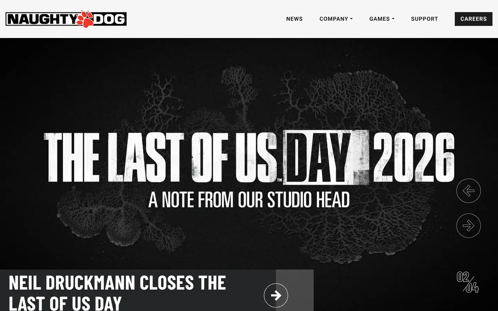
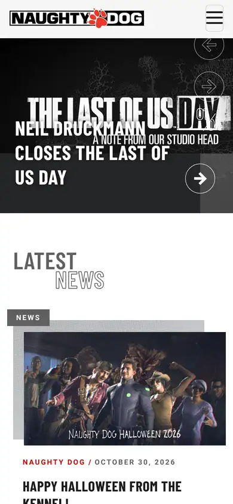

# naughty-dog

https://www.naughtydog.com
Tags: games, dark
Picked because: Naughty Dog: dark, story-driven studio

## What makes it work
Heavy condensed caps over a dark textured background; story-first.

## Good reference for
Announcement and news heroes.

## Lesson for RUIN-1
Condensed heavy caps on dark texture: strong for launch news.

## Measured (from the live page)
- First screen: dark (average brightness 0.272)
- Background: #e8e8e8; palette by area: #606060 at 70%, #252627, #1c1c1c, #f6f6f6, #ffffff, #606060; accent: #007aff
- Fonts: Roboto, Barlow Condensed
- Headline: Barlow Condensed, 54px, weight 700, uppercase, tracking 0.5px (“Announcing Intergalactic: The Heretic Prophet, a New Franchi”)
- Section title: Barlow Condensed, 80px, weight 600, uppercase, tracking 0.5px (“Latest News”)
- Body: Roboto, 18px, weight 400, tracking 0.5px (“Pumpkin picks and fall fun with the Dogs.”)
- Navigation: Roboto, 16px, weight 700, uppercase, tracking 1px (“News”)
- Buttons: “Careers” 40px tall, radius 0px, 16px 700 uppercase
- Section spacing (median vertical padding): 50px; page height 4186px
- Phone: headline 32px, side margin 22px

## Screenshots
 

Whole page: [desktop](desktop-full.webp) · [phone](phone-full.webp)
