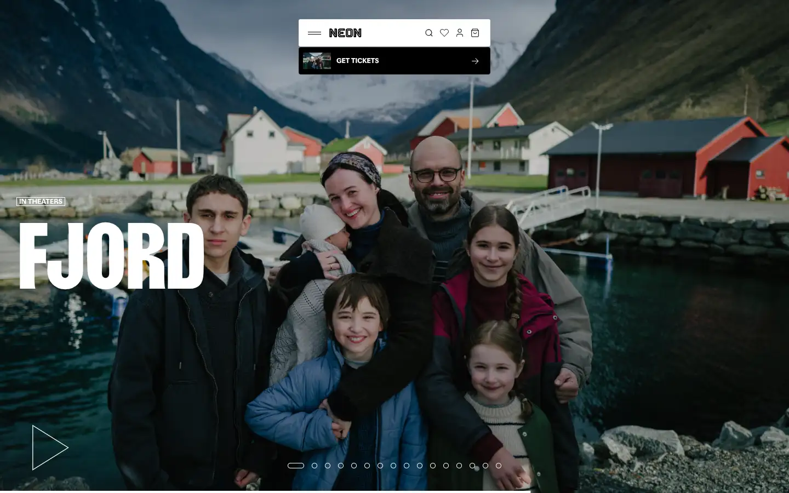
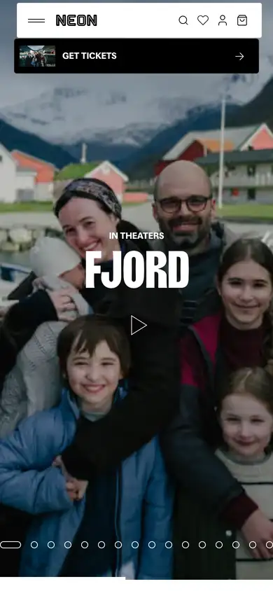

# neon

https://neonrated.com
Tags: lorn, film
Picked because: Neon: bold, cinematic film distributor

## What makes it work
Condensed, very heavy titles over full-bleed stills, a dark floating nav pill.

## Good reference for
Release or launch heroes.

## Lesson for RUIN-1
Condensed heavy type gives instant poster energy.

## Measured (from the live page)
- First screen: dark (average brightness 0.239)
- Background: #ffffff; palette by area: #f3f3f3, #000000 at 20%, #ffffff at 8%, #ffffff, #ffffff at 20%; accent: none
- Fonts: Focal, Girott
- Headline: Girott, 160px, weight 700, uppercase, tracking -4.8px (“Fjord”)
- Section title: not measured
- Body: Focal, 14px, weight 400, tracking -0.16px (“$65USD”)
- Navigation: not measured
- Buttons: “Get Tickets” 50px tall, radius 4px, 14px 400 none, border 1px rgba(255, 255, 255, 0.1); “ONCE UPON A TIME IN HARLEM Hoo” 50px tall, radius 4px, 14px 400 none, border 0px rgb(229, 231, 235); “NTBTS 18X24 Limited Edition Po” 50px tall, radius 4px, 14px 400 none, border 0px rgb(229, 231, 235); “HOPE Embroidered Equestrian Cl” 50px tall, radius 4px, 14px 400 none, border 0px rgb(229, 231, 235)
- Section spacing (median vertical padding): ?; page height 6190px
- Phone: headline 70px, side margin 120px

## Screenshots
 

Whole page: [desktop](desktop-full.webp) · [phone](phone-full.webp)
