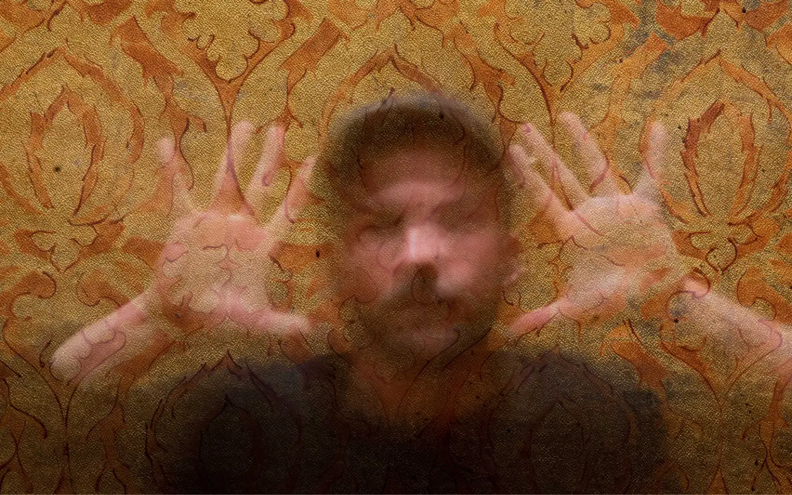
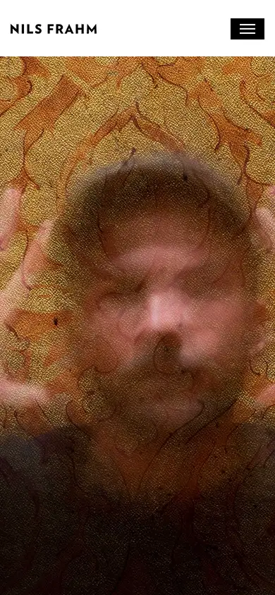

# nils-frahm

https://www.nilsfrahm.com
Tags: lorn, music, analog
Picked because: Nils Frahm: analog, warm, crafted musician site

## What makes it work
Texture everywhere: a warm, grainy, distorted portrait over a patterned ground; thin wide-tracked caps.

## Good reference for
Texture-led heroes, about pages.

## Lesson for RUIN-1
Grain and warmth make digital feel analog: the same job tape wear does in the synth.

## Measured (from the live page)
- First screen: light (average brightness 0.355)
- Background: #ffffff; palette by area: #f0f0f0, #ffffff, #656565; accent: none
- Fonts: Verlag 3r
- Headline: Verlag 3r, 26px, weight 300, uppercase, tracking 3px (“Dear Music Lover”)
- Section title: Verlag 3r, 26px, weight 300, uppercase, tracking 3px (“Dear Music Lover”)
- Body: Verlag 3r, 17px, weight 300, tracking 0.5px (“Welcome to my gallery. Here you can find out more about what”)
- Navigation: Verlag 3r, 13px, weight 700, uppercase, tracking 0.5px (“News”)
- Buttons: “Read Full Biography” 40px tall, radius 0px, 14px 700 uppercase, border 2px rgb(0, 0, 0); “Show more” 40px tall, radius 0px, 14px 700 uppercase, border 2px rgb(0, 0, 0)
- Section spacing (median vertical padding): ?; page height 3251px
- Phone: headline 35px, side margin 15px

## Screenshots
 

Whole page: [desktop](desktop-full.webp) · [phone](phone-full.webp)
