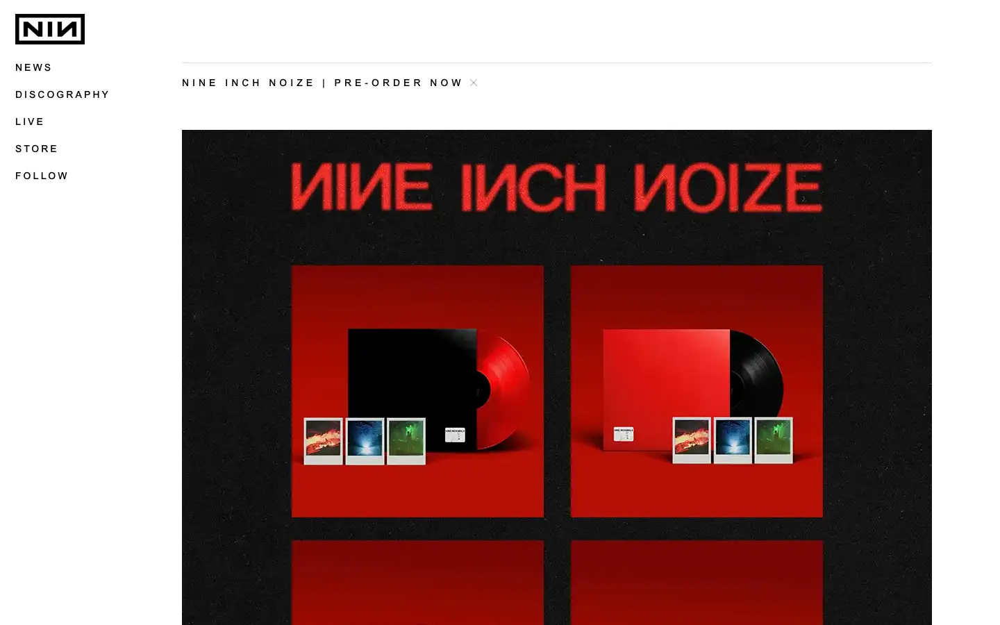
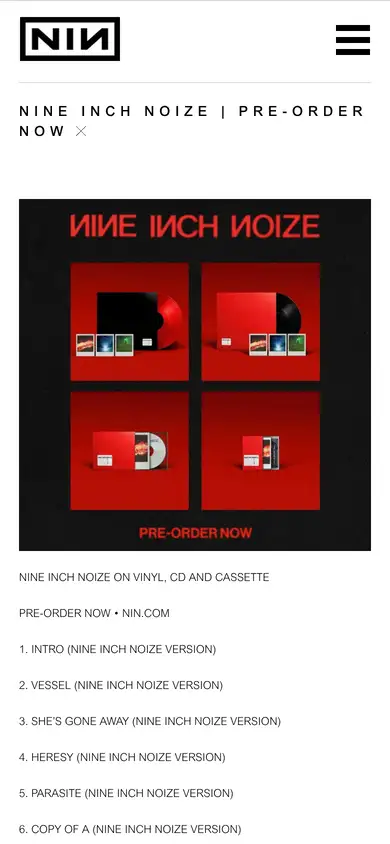

# nin

https://www.nin.com
Tags: lorn, music, dark, industrial
Picked because: Nine Inch Nails: industrial, dark, minimal artist site

## What makes it work
Black, red and a hard industrial logo; one product block in the centre, nav as a short vertical list.

## Good reference for
Dark merch or edition pages.

## Lesson for RUIN-1
Restraint: two colours and one object can feel heavier than a whole page of effects.

## Measured (from the live page)
- First screen: light (average brightness 0.488)
- Background: #ffffff; palette by area: #ffffff, #666666, #1a1a1a; accent: none
- Fonts: Open Sans, Arial MT Pro, Arial MT Std
- Headline: not measured
- Section title: not measured
- Body: Arial MT Std, 11px, weight 300, uppercase (“<img decoding="async" class="alignnone size-full wp-image-32”)
- Navigation: Arial MT Pro, 15px, weight 300, uppercase, tracking 3px (“News”)
- Buttons: none found
- Section spacing (median vertical padding): 450px; page height 5446px
- Phone: headline ?, side margin 19px

## Screenshots
 

Whole page: [desktop](desktop-full.webp) · [phone](phone-full.webp)
