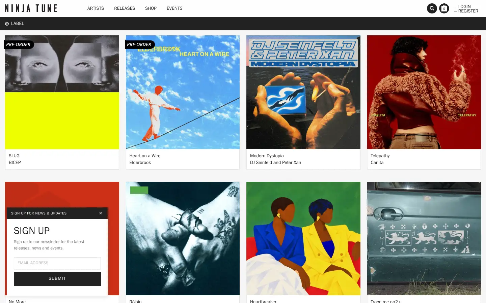
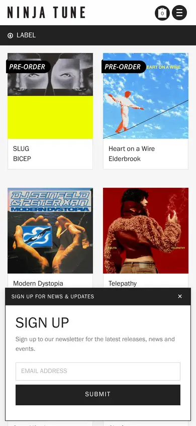

# ninja-tune

https://ninjatune.net
Tags: lorn, music, label
Picked because: LORN's own label: how a dark electronic label presents artists and releases

## What makes it work
A wall of square record covers does all the work; the chrome stays tiny, grey and out of the way.

## Good reference for
Release grids, catalogue pages.

## Lesson for RUIN-1
Let the sound's artwork (the synth's prints) be the colour; keep the frame quiet.

## Measured (from the live page)
- First screen: light (average brightness 0.588)
- Background: #f6f6f6; palette by area: #000000 at 50%, #ffffff, #337ab7, #222222, #ffffff at 90%, #ffffff at 10%; accent: #337ab7
- Fonts: Helvetica, franklingothicregular, Glyphicons Halflings
- Headline: franklingothicregular, 30px, weight 400, uppercase (“Sign Up”)
- Section title: franklingothicregular, 30px, weight 400, uppercase (“Sign Up”)
- Body: franklingothicregular, 13px, weight 400 (“Sign up to our newsletter for the latest releases, news and ”)
- Navigation: franklingothicregular, 14px, weight 400, uppercase (“Artists”)
- Buttons: “Submit” 41px tall, radius 0px, 13px 400 uppercase
- Section spacing (median vertical padding): ?; page height 11139px
- Phone: headline ?, side margin 31px

## Screenshots
 

Whole page: [desktop](desktop-full.webp) · [phone](phone-full.webp)
