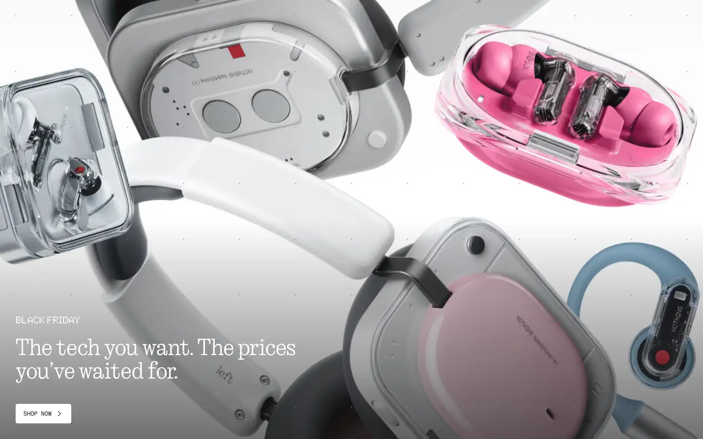
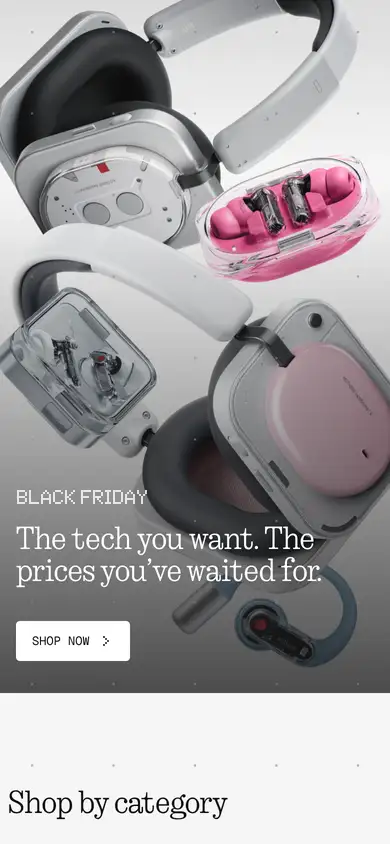

# nothing

https://nothing.tech
Tags: product, hardware, type-led
Picked because: Nothing: distinctive type and dot-matrix identity

## What makes it work
A dot-matrix and mono identity; bold product photography; big serif-ish headline at the bottom left.

## Good reference for
Distinctive type systems.

## Lesson for RUIN-1
An ownable type detail (like their dot font) makes a brand recognisable at a glance.

## Measured (from the live page)
- First screen: light (average brightness 0.678)
- Background: #f4f4f4; palette by area: #f4f4f4, #040404, #595a5a at 5%, #d8d9d9 at 50%, #ffffff at 5%, #ffffff; accent: none
- Fonts: NType82-Regular, Ndot-Regular, LatteraMonoLL, Ndot-Bold, Geist Mono Variable, Geist Variable
- Headline: NType82-Regular, 48px, weight 400 (“The tech you want. The prices you’ve waited for.”)
- Section title: NType82-Regular, 48px, weight 400 (“Shop by category”)
- Body: Ndot-Bold, 20px, weight 57, uppercase (“Black Friday”)
- Navigation: LatteraMonoLL, 11px, weight 400, uppercase (“Account”)
- Buttons: “Shop now” 40px tall, radius 4px, 16px 400 none, border 0px rgb(229, 231, 235); “Discover” 40px tall, radius 4px, 16px 400 none, border 0px rgb(229, 231, 235); “Read the interview” 40px tall, radius 4px, 16px 400 none, border 0px rgb(229, 231, 235); “Discover the campaign” 40px tall, radius 4px, 16px 400 none, border 0px rgb(229, 231, 235)
- Section spacing (median vertical padding): 288px; page height 8859px
- Phone: headline 32px, side margin 16px

## Screenshots
 

Whole page: [desktop](desktop-full.webp) · [phone](phone-full.webp)
